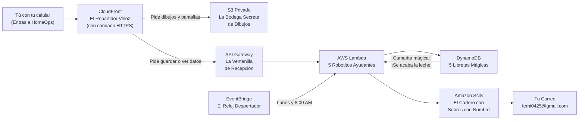

# Guía de Estudio Súper Fácil: La Casa Mágica de HomeOps en la Nube (AWS)

> **¿Para qué sirve esta guía?**
> Explica **exactamente lo mismo** que construimos en AWS para HomeOps, pero usando cuentos, ejemplos de la vida diaria y palabras sencillas, **como si se lo explicaras a un niño de 8 años** (¡y también sirve muchísimo para entender los conceptos antes de repasar los nombres técnicos!).

---

## La Gran Idea: ¿Qué es "la nube" y qué hicimos?

Imagina que en lugar de comprar un edificio enorme y dejar las luces prendidas todo el día (aunque nadie esté adentro), construimos una **Casa Mágica Inteligente** llamada **HomeOps** usando piezas de LEGO de **Amazon Web Services (AWS)**.

Lo mejor de esta Casa Mágica es que es **Serverless** (sin servidores encendidos 24/7):
> **Los robotitos ayudantes duermen cuando nadie usa la app y solo se despiertan 1 segundo cuando aprietas un botón.** ¡Por eso nos cuesta **$0 pesos**!

Todas nuestras piezas viven en el mismo vecindario de Estados Unidos llamado **`us-east-1` (Virginia del Norte)**, para que se puedan pasar las cosas rapidísimo sin tener que viajar lejos.

---

## El Mapa de Nuestra Casa Mágica

---

## Conoce a los 10 Personajes (Servicios de AWS)

---

### 1. AWS Budgets — La Alcancía con Alarma

- **¿Qué es?** Una alcancía con alarma que vigila que no gastemos dinero de más.
- **Ejemplo:** Le dijimos a mamá: *"Si llego a gastar aunque sea **1 centavo de dólar ($0.01)** este mes, mándame un correo corriendo para avisarme"*.
- **Qué hicimos en HomeOps:** Creamos la alarma **`HomeOps-ZeroSpend-Alert`** apuntando al correo `ferni0425@gmail.com`.
- **¿Por qué?** Para dormir tranquilos sabiendo que todo sigue siendo gratis.
- **Dónde la ves en la Consola de AWS:** Buscas **Billing and Cost Management** → **Budgets** → ahí está `HomeOps-ZeroSpend-Alert` con su foquito verde de todo bien.

---

### 2. AWS IAM — El Guardia de la Puerta y los Gafetes

- **¿Qué es?** El guardia que reparte **gafetes de permisos** para que cada quien entre solo al cuarto que le toca.
- **Ejemplo:**
  - El **dueño de la casa (Root)** tiene la llave maestra de TODO, así que la guarda bajo llave y nunca la saca a la calle.
  - Al **constructor (`homeops-deployer`)** le dimos un gafete especial para construir cuartos y subir código desde nuestra computadora.
  - Al **robotito de la leche (`homeops-lambda-stream-role`)** le dimos un gafete chiquito que dice: *"Tú SOLO puedes mirar la libreta de la despensa y mandar cartas de despensa. No puedes abrir la libreta de contraseñas"*.
  - A los **robotitos principales (`homeops-lambda-api-role`)** les dimos gafete para abrir las libretas y hablar con el cartero.
  - Al **reloj despertador (`homeops-eventbridge-scheduler-role`)** le dimos permiso **solo** para despertar al robotito del horario.
- **¿Por qué?** Si un robotito se equivoca o alguien intenta engañarlo, nunca podrá hacer travesuras en cuartos donde no tiene permiso. A esto los adultos le llaman **Privilegio Mínimo**.
- **Dónde lo ves en la Consola de AWS:** Buscas **IAM** → en **Users** está `homeops-deployer` y en **Roles** están los 3 gafetes que empiezan con `homeops-`.

---

### 3. Amazon DynamoDB — Las 5 Libretas Mágicas (y la Camarita Espía)

- **¿Qué es?** Un mueble con **5 libretas mágicas súper rápidas** donde anotamos todo lo de la casa en tarjetitas (en vez de hojas de Excel gigantes).
- **Nuestras 5 libretas:**
  1. **`homeops-usuarios`**: quién vive en la casa (Fernando, Elena, Sofía, Mateo), su PIN secreto, su color y su correo. Además tiene un **separador de colores (`nombre-index`)** para encontrar a "Fernando" en 1 segundo sin leer toda la libreta.
  2. **`homeops-productos`**: qué hay en la despensa (Leche, Café, Pollo, Papel, Arroz...), cuánto queda y cuánto es lo mínimo.
  3. **`homeops-kanban-columnas`**: los 3 letreros del pizarrón (*Por hacer*, *En progreso*, *Completado*).
  4. **`homeops-tareas`**: los quehaceres de la casa (sacar la basura, regar plantas, pagar recibos...).
  5. **`homeops-tareas-historial`**: el diario donde se apunta cada vez que alguien crea o mueve una tarea, ordenado por fecha.
- **¿Qué es DynamoDB Streams?** Es una **camarita mágica** que pusimos viendo la libreta **`homeops-productos`**. Cada vez que alguien cambia un número en esa libreta, la camarita toma **dos fotos** (`NEW_AND_OLD_IMAGES`): una de **cómo estaba antes** y otra de **cómo quedó ahora**, y se las pasa corriendo a un robotito.
- **¿Por qué le pusimos un límite de 19 fichitas?** AWS nos regala **25 fichitas gratis** para siempre (25 lecturas y 25 escrituras por segundo). Nosotros repartimos solo **19 fichitas** entre las 5 libretas para nunca pasarnos del regalo gratuito.
- **Dónde lo ves en la Consola de AWS:** Buscas **DynamoDB** → **Tables** (ahí están las 5 libretas). Si entras a **Explore items** puedes leer las tarjetitas una por una. Si entras a `homeops-productos` → **Exports and streams**, ves la camarita encendida.

---

### 4. Amazon SNS — El Cartero Mágico con Sobres con Nombre

- **¿Qué es?** Un cartero súper veloz que entrega avisos por correo electrónico a la familia.
- **Ejemplo:** Tenemos **dos megáfonos (Tópicos)**:
  1. **`homeops-alertas-despensa` (Megáfono de la Cocina):** Cuando se acaba la leche, el cartero le avisa a **toda la familia** para que quien pase por el súper la compre.
  2. **`homeops-avisos-tareas` (Buzón con Sobres con Nombre):** Aquí cada correo tiene una **etiqueta secreta (`Filter Policy`)**. Si sale una tarea con la etiqueta *"Para: Fernando"*, el cartero mira los nombres en cada buzón y **solo se la entrega a Fernando**, sin molestar a Elena ni a Mateo.
- **¿Qué truco genial le agregamos?** Cuando en la app alguien escribe su correo en su perfil (en la pantalla **Familia y acceso PIN**), nuestro robotito automáticamente va con el cartero y le dice: *"Oye, anota este correo nuevo con el nombre de esta persona"*. El cartero le manda un correo preguntando *"¿De verdad eres tú? Haz clic aquí para confirmar"*. ¡Cuando la persona hace clic, ya empieza a recibir sus avisos!
- **Dónde lo ves en la Consola de AWS:** Buscas **Simple Notification Service (SNS)** → **Topics** (verás los 2 megáfonos). Si entras a `homeops-avisos-tareas` → **Subscriptions**, ves los correos en verde (`Confirmed`) y en **Subscription filter policy** ves la etiqueta con su nombre (`usr_admin` y `familia`).

---

### 5. AWS Lambda — Los 5 Robotitos Ayudantes

- **¿Qué es?** En lugar de tener una computadora encendida todo el día, tenemos **5 robotitos chiquitos** especializados. Cuando nadie los llama, duermen y no gastan luz. Cuando llega un mensaje, se despiertan en un parpadeo, hacen su trabajo y se vuelven a dormir.
- **Conoce al equipo:**
  1. **`homeops-auth` (El Portero):** Revisa tu contraseña o tu PIN de 4 números, te da un pase VIP (token JWT) para entrar, y le avisa al cartero SNS cuando alguien cambia su correo en su perfil. *(Si alguien intenta adivinar el PIN mal 5 veces seguidas, le cierra la puerta 5 minutos).*
  2. **`homeops-inventario` (El Encargado de la Despensa):** Cuenta cuántos litros de leche quedan, los suma cuando regresas del súper y calcula el precio promedio.
  3. **`homeops-kanban` (El Organizador de Tareas):** Mueve tarjetitas en el pizarrón, anota en el diario quién la movió y le dice al cartero si una tarea es **urgente** o de **sacar la basura**.
  4. **`homeops-stock-alerts` (El Vigilante de la Leche):** Mira las dos fotos de la camarita de DynamoDB. Si ve que la leche bajó de 2 litros a 1 litro, grita al megáfono: *"¡Atención: queda solo 1 L de Leche Entera!"*. Si alguien solo cambió el precio pero la leche sigue igual, se queda calladito para no hacer spam.
  5. **`homeops-tareas-cron` (El Robotito del Calendario):** Solo trabaja cuando lo despierta el reloj despertador: los lunes regresa las tareas semanales al inicio, y todas las mañanas revisa qué vence hoy.
- **¿Por qué pesan tan poquito (~14 KB)?** Porque ya traen las herramientas de AWS instaladas en su mochila (Node.js 22), así que no tuvimos que meter cajas pesadas adentro y corren en chips rápidos y ahorradores (`arm64`).
- **Dónde los ves en la Consola de AWS:** Buscas **Lambda** → **Functions**. Ahí están los 5 robotitos. Si entras a `homeops-stock-alerts`, verás un dibujito arriba donde la libreta **DynamoDB** le manda señales directo al robotito.

---

### 6. Amazon API Gateway — La Ventanilla de Recepción

- **¿Qué es?** La ventanilla única a la que llegan todas las peticiones de la app para saber a qué robotito llamar.
- **Ejemplo:** Cuando tu celular dice *"Quiero ver el inventario"* (`/api/protected/inventario`), la recepcionista (`homeops-api`) ve el letrero `/inventario` y le pasa el papelito al robotito `homeops-inventario`. Si dice `/kanban`, se lo pasa a `homeops-kanban`. Si dice `/auth`, se lo pasa a `homeops-auth`.
- **Qué hicimos:** Creamos la ventanilla **`homeops-api`** (`7ywpyl88of`) y abrimos la puerta oficial llamada **`prod`**.
- **Dónde la ves en la Consola de AWS:** Buscas **API Gateway** → **`homeops-api`** → en **Resources** ves el mapa de ventanillas (`/api/auth`, `/api/protected/inventario`, `/kanban`, `/usuarios`) y en **Stages → prod** ves su dirección web.

---

### 7. Amazon S3 — La Bodega Secreta de Dibujos (Frontend)

- **¿Qué es?** Una bodega enorme donde guardamos los archivos bonitos de la página web (los colores, botones, íconos y pantallas hechas en React).
- **Ejemplo:** En lugar de dejar la puerta de la bodega abierta para que cualquier extraño entre desde la calle, **le pusimos un candado gigante (`Block all public access`)**. Si alguien intenta abrir la puerta directa de S3, un cartel le dice **"¡PROHIBIDO! Error 403"**.
- **¿Quién SÍ tiene llave?** Solo nuestro Repartidor Veloz (**CloudFront**), usando una llave especial con firma mágica (**OAC**).
- **Truco de velocidad:** A los dibujos que nunca cambian les pusimos una etiqueta que dice *"guárdalos en tu mochila 1 año"*; pero al mapa principal (`index.html`) le pusimos *"revisa siempre si hay versión nueva"*, así cuando actualizamos la app, todos ven los cambios al instante.
- **Dónde la ves en la Consola de AWS:** Buscas **S3** → **`homeops-frontend-338952532655`**. En **Objects** ves los archivos de la página (`index.html` y `assets/`) y en **Permissions** ves el candado bloqueado al público + el permiso exclusivo para CloudFront.

---

### 8. Amazon CloudFront — El Repartidor Veloz con Candado HTTPS

- **¿Qué es?** Un equipo de repartidores repartidos por todo el mundo que te entregan la página súper rápido y dentro de un sobre blindado con candado (**HTTPS**).
- **Por qué es la estrella del show:**
  1. **Nos da una dirección única y segura:** `https://d1e38o8e144pln.cloudfront.net`.
  2. **Sabe ir a dos lugares distintos (Dual Origin):**
     - Si pides una pantalla (`/inventario`, `/kanban`, `/perfiles`), va a la **Bodega S3**.
     - Si pides datos (`/api/...`), **no guarda copias viejas (`CachingDisabled`)**, lleva tu pase VIP (`Authorization` gracias a `AllViewerExceptHostHeader`) y va directo a la **Ventanilla de API Gateway**.
  3. **Tiene un duendecito traductor (`homeops-spa-rewrite`):** Si aprietas F5 estando en `/kanban`, en la bodega S3 no existe un archivo llamado "kanban". El duendecito rápidamente cambia el letrero por `/index.html` para que la app abra normal y nunca te muestre un feo error `404`.
- **Dónde lo ves en la Consola de AWS:** Buscas **CloudFront** → **Distributions** → **`EVQ7QPGQ82AIO`**. En **Origins** ves los dos lugares a donde va (S3 y API Gateway), en **Behaviors** ves la regla `/api/*` y `Default (*)`, y en **Functions** ves al duendecito `homeops-spa-rewrite`.

---

### 9. Amazon EventBridge Scheduler — El Reloj Despertador Mágico

- **¿Qué es?** Un reloj despertador en la nube con hora de México (`America/Mexico_City`).
- **Qué alarmas pusimos:**
  1. **`homeops-reinicio-semanal`:** Suena **cada lunes a las 12:01 de la madrugada** y le dice al robotito del calendario: *"¡Nueva semana! Regresa todas las tareas repetitivas a 'Por hacer'"*.
  2. **`homeops-recordatorio-diario`:** Suena **todos los días a las 8:00 de la mañana** y le dice: *"Revisa qué tareas vencen hoy o a quién le toca sacar la basura y mándales un correo"*.
- **Dónde lo ves en la Consola de AWS:** Buscas **Amazon EventBridge** → menú izquierdo **Scheduler → Schedules** → ahí están las 2 alarmas prendidas en verde (`Enabled`).

---

### 10. Amazon CloudWatch Logs — El Cuaderno de Bitácora

- **¿Qué es?** Un cuaderno gigante donde todos los robotitos anotan lo que hicieron y si algo les salió mal.
- **Ejemplo:** Cuando probamos bajar la leche a 1 litro, abrimos este cuaderno y leímos escrito por el robotito:
  > `Alerta SNS enviada para Leche Entera (actual=1, min=1)`
  Así supimos 100% que sí funcionó sin adivinar.
- **Dónde lo ves en la Consola de AWS:** Buscas **CloudWatch** → **Logs → Log groups** → escribes `/aws/lambda/homeops` y puedes leer el diario de cada robotito.

---

## Historia Completa en 30 Segundos (Ejemplo Real: "¡Se acabó la leche!")

1. Abres `https://d1e38o8e144pln.cloudfront.net` en tu celular → **CloudFront** saca los dibujos de la **Bodega S3** y te los muestra con candado **HTTPS**.
2. Tocaste tu foto y pusiste tu PIN `1234` → **API Gateway** le pregunta al robotito **Portero (`homeops-auth`)**, que revisa tu **Libreta de Usuarios (`DynamoDB`)** y te da tu pase VIP.
3. En la cocina ves *Leche Entera (2 L)* y aprietas **`-1`** → **API Gateway** le avisa al robotito de **Inventario (`homeops-inventario`)**, que borra el `2` y escribe `1` en la **Libreta de Productos**.
4. La **Camarita Mágica (`DynamoDB Streams`)** ve el cambio (`antes: 2`, `ahora: 1`) y despierta al robotito **Vigilante (`homeops-stock-alerts`)**.
5. El Vigilante comprueba que `1 <= mínimo` y que sí bajó → le grita al **Cartero (`SNS`)**.
6. ¡Ring! En 5 segundos te llega el correo: **"Atención: Queda solo 1 L de Leche Entera"** y el robotito anota en su **Cuaderno (`CloudWatch`)** que la misión fue un éxito.

---

## Mini Glosario de Bolsillo (Para recordar rápido)

| Palabra difícil de AWS | Qué significa en fácil |
| :--- | :--- |
| **Serverless** | Robotitos que duermen cuando no trabajan (solo cobran los segundos que se usan). |
| **Free Tier** | El regalo gratuito de AWS mientras no te pases de los límites. |
| **IAM Role** | El gafete con permisos chiquitos que usa un robotito. |
| **DynamoDB** | Las libretas mágicas rápidas donde guardamos los datos. |
| **DynamoDB Stream** | La camarita que toma foto "antes y después" cuando cambia una libreta. |
| **SNS + Filter Policy** | El cartero con sobres con nombre para que el correo llegue solo a quien le toca. |
| **Lambda** | Cada robotito ayudante que ejecuta nuestro código. |
| **API Gateway** | La ventanilla de recepción que reparte los recados al robotito correcto. |
| **S3 Privado + OAC** | La bodega con candado donde solo entra el repartidor oficial con su llave especial. |
| **CloudFront** | El repartidor veloz con HTTPS que une las pantallas (S3) y los recados (`/api/*`). |
| **EventBridge Scheduler** | El reloj despertador mágico para tareas semanales y diarias. |
| **CloudWatch** | El cuaderno donde los robotitos escriben qué hicieron. |
