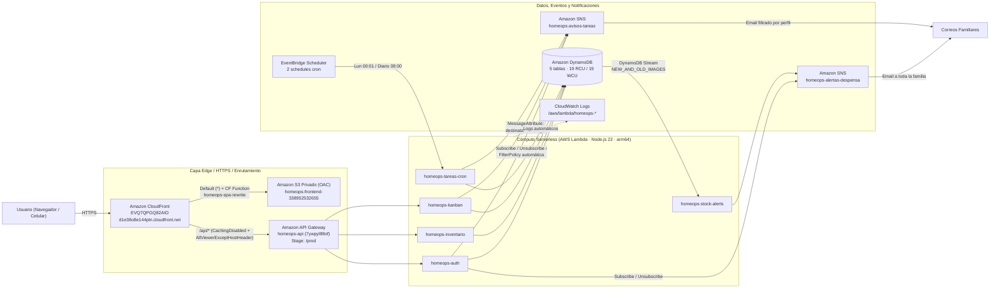

# Guía de Estudio Técnica: Arquitectura Serverless de HomeOps / DomusHub en AWS

> **Entorno real documentado:** Cuenta AWS `338952532655` · Región `us-east-1` (US East — N. Virginia) · URL en producción: `https://d1e38o8e144pln.cloudfront.net`
>
> Esta guía explica **qué es cada servicio de AWS que usamos**, **cómo funciona por dentro**, **exactamente qué creamos y por qué se tomó cada decisión técnica**, y **cómo localizar y verificar cada pieza desde la Consola Web de AWS** (ideal para estudiar, exponer o defender el proyecto).

---

## Tabla de Contenidos

1. [Mapa General de la Arquitectura](#1-mapa-general-de-la-arquitectura)
2. [Los 4 Flujos Completos del Sistema](#2-los-4-flujos-completos-del-sistema)
3. [Servicio por Servicio: Qué es, Qué hicimos, Por qué y Cómo verlo en Consola](#3-servicio-por-servicio-qué-es-qué-hicimos-por-qué-y-cómo-verlo-en-consola)
   - [3.1 AWS Budgets (Control de Costos y Free Tier)](#31-aws-budgets-control-de-costos-y-free-tier)
   - [3.2 AWS IAM (Identidad, Roles y Privilegio Mínimo)](#32-aws-iam-identidad-roles-y-privilegio-mínimo)
   - [3.3 Amazon DynamoDB + GSI + DynamoDB Streams](#33-amazon-dynamodb--gsi--dynamodb-streams)
   - [3.4 Amazon SNS (Pub/Sub, Filter Policies y Suscripción por Perfil)](#34-amazon-sns-pubsub-filter-policies-y-suscripción-por-perfil)
   - [3.5 AWS Lambda (Cómputo Serverless en Node.js 22 + ARM64)](#35-aws-lambda-cómputo-serverless-en-nodejs-22--arm64)
   - [3.6 Amazon API Gateway (REST API Regional + Lambda Proxy)](#36-amazon-api-gateway-rest-api-regional--lambda-proxy)
   - [3.7 Amazon S3 (Almacenamiento Privado de Objetos)](#37-amazon-s3-almacenamiento-privado-de-objetos)
   - [3.8 Amazon CloudFront (CDN, OAC, Dual Origin y CloudFront Functions)](#38-amazon-cloudfront-cdn-oac-dual-origin-y-cloudfront-functions)
   - [3.9 Amazon EventBridge Scheduler (Tareas Programadas)](#39-amazon-eventbridge-scheduler-tareas-programadas)
   - [3.10 Amazon CloudWatch Logs (Monitoreo y Depuración)](#310-amazon-cloudwatch-logs-monitoreo-y-depuración)
4. [Automatización de Despliegues (Scripts AWS CLI)](#4-automatización-de-despliegues-scripts-aws-cli)
5. [Decisiones de Arquitectura Clave (El "Por Qué" para Defensa)](#5-decisiones-de-arquitectura-clave-el-por-qué-para-defensa)
6. [Preguntas Frecuentes de Examen / Defensa con Respuestas Modelo](#6-preguntas-frecuentes-de-examen--defensa-con-respuestas-modelo)

---

## 1. Mapa General de la Arquitectura

HomeOps opera con una arquitectura **100% Serverless** (sin servidores EC2 encendidos 24/7, sin bases de datos SQL que mantener y escalando a cero cuando nadie usa la app), diseñada para mantenerse dentro del **AWS Free Tier** en una única región (`us-east-1`).

### ¿Por qué elegimos `us-east-1` (N. Virginia)?
- Es la región principal de AWS: todos los servicios serverless están disponibles, tiene los precios más bajos fuera del Free Tier y **CloudFront / Budgets / IAM** son servicios globales cuyo plano de control reside en `us-east-1`.
- Mantener DynamoDB, Lambda, SNS, API Gateway, S3 y EventBridge en la **misma región** elimina costos de transferencia inter-región y reduce la latencia entre servicios a unos pocos milisegundos.

---

## 2. Los 4 Flujos Completos del Sistema

### Flujo 1 — Carga de la aplicación web y navegación SPA (Síncrono)
1. El usuario entra a `https://d1e38o8e144pln.cloudfront.net/kanban` (o presiona F5 en cualquier ruta).
2. **CloudFront** intercepta la petición antes de ir a S3 y ejecuta la CloudFront Function **`homeops-spa-rewrite`** (`viewer-request`).
3. Como `/kanban` no tiene punto de extensión (`.js`, `.css`, `.svg`), la función reescribe el URI a `/index.html`.
4. CloudFront firma la solicitud con **OAC (Origin Access Control)** usando SigV4 y lee `/index.html` desde el bucket privado **`homeops-frontend-338952532655`** en **S3**.
5. El navegador recibe `index.html` con HTTP `200`, descarga los bundles JS/CSS cacheados en el borde por 1 año (`max-age=31536000, immutable`), y React Router renderiza `/kanban`.

### Flujo 2 — Uso de la API: Login, Inventario, Compras y Kanban (Síncrono)
1. React hace peticiones a `/api/...` (mismo dominio que CloudFront, sin problemas de CORS en producción).
2. CloudFront detecta el patrón `/api/*`, desactiva el caché (`CachingDisabled`), reenvía todos los headers/query strings incluyendo `Authorization: Bearer <JWT>` (`AllViewerExceptHostHeader`) y redirige al Origin 2: **API Gateway** (`7ywpyl88of.execute-api.us-east-1.amazonaws.com/prod`).
3. API Gateway usa **Lambda Proxy Integration (`AWS_PROXY`)** para invocar `homeops-auth`, `homeops-inventario` o `homeops-kanban`.
4. La Lambda valida el JWT (HS256 firmado con `JWT_SECRET`), ejecuta la operación en **DynamoDB** y devuelve JSON con status HTTP estándar (`200`, `201`, `400`, `401`, `403`, `404`, `422`).

### Flujo 3 — Alerta automática de stock bajo (Asíncrono orientado a eventos)
1. En la cocina, alguien pulsa **`-1`** en *Leche Entera* → `PATCH /api/protected/inventario/prod_leche/stock`.
2. `homeops-inventario` descuenta `cantidad_actual` en la tabla `homeops-productos` y recalcula `porcentaje_visual` (25% rojo cuando `actual <= mínima`).
3. **DynamoDB Streams** (`NEW_AND_OLD_IMAGES`) captura automáticamente la imagen anterior (`OldImage`) y la nueva (`NewImage`) del registro modificado.
4. El **Event Source Mapping** de AWS Lambda (filtrado a `INSERT` y `MODIFY`) invoca de forma asíncrona a **`homeops-stock-alerts`**.
5. `homeops-stock-alerts` verifica la regla anti-spam: alerta **solo** si `nuevaCant <= minimo` **y** además bajó la cantidad, cruzó el umbral o es una inserción nueva (así editar solo el precio nunca manda correos repetidos).
6. Si cumple, publica en **`homeops-alertas-despensa`** (Amazon SNS) y AWS envía el correo automáticamente a todos los correos suscritos confirmados.

### Flujo 4 — Suscripción automática por perfil + Avisos de tareas y basura (Pub/Sub filtrado + Cron)
1. Cuando en `/perfiles` se guarda o edita el correo de un integrante, **`homeops-auth`** guarda el usuario en DynamoDB y llama automáticamente a Amazon SNS para:
   - Suscribir ese correo a **`homeops-avisos-tareas`** con `FilterPolicy: {"destinatario": ["<id_del_perfil>", "familia"]}` (`FilterPolicyScope: MessageAttributes`).
   - Suscribir ese correo a **`homeops-alertas-despensa`**.
   - Si el perfil cambia de correo o se elimina, desuscribe el correo anterior (o ajusta el `FilterPolicy` si otro perfil comparte el correo).
2. Cuando se crea/reasigna una tarea **urgente** o de **turno de basura** (`homeops-kanban`), o cuando **EventBridge Scheduler** dispara **`homeops-tareas-cron`** (diario 8:00 AM), se publica en `homeops-avisos-tareas` con el atributo `destinatario = asignado_a_user_id` (o `"familia"`).
3. SNS evalúa los **Filter Policies** y entrega el correo **únicamente** al integrante responsable (y guarda `ultima_alerta_fecha` para evitar spam el mismo día).
4. Además, cada lunes a las 00:01 AM (`America/Mexico_City`), EventBridge Scheduler invoca `homeops-tareas-cron` con `{"action": "reiniciar_recurrentes"}` para regresar las tareas semanales a la columna `"Por hacer"`.

---

## 3. Servicio por Servicio: Qué es, Qué hicimos, Por qué y Cómo verlo en Consola

> **Tip antes de navegar la Consola Web de AWS:** Revisa siempre la esquina superior derecha de la barra azul/negra de AWS y asegúrate de tener seleccionada la región **`US East (N. Virginia) us-east-1`** (en IAM, CloudFront y Budgets aparecerá como **Global**).

---

### 3.1 AWS Budgets (Control de Costos y Free Tier)

- **¿Qué es?** Servicio dentro de *Billing and Cost Management* que monitorea tus gastos reales y proyectados de AWS y dispara alertas por correo/SNS cuando superas un umbral.
- **¿Cómo funciona?** Evalúa periódicamente tu consumo facturable acumulado del mes contra el límite configurado (`BudgetLimit`) y las reglas de notificación (`ACTUAL` o `FORECASTED`).
- **¿Qué hicimos en HomeOps?**
  - Creamos el presupuesto **`HomeOps-ZeroSpend-Alert`** (`MONTHLY`, tipo `COST`, límite **`0.01 USD`**, notificación cuando el gasto `ACTUAL > 100%` del límite, enviando correo a `ferni0425@gmail.com`).
- **¿Por qué lo hicimos?** Para detectar de inmediato cualquier recurso mal configurado o salida accidental de la Capa Gratuita antes de acumular cargos.
- **Cómo verlo en la Consola Web de AWS:**
  1. En el buscador superior escribe **`Billing and Cost Management`** y ábrelo.
  2. En el menú izquierdo entra a **Budgets**.
  3. Verás la tabla con **`HomeOps-ZeroSpend-Alert`** (límite `$0.01`, estado `OK` / `HEALTHY`).
  4. Al hacer clic en él verás las gráficas de *Current vs. budgeted* y en la pestaña **Alerts** la regla `Actual > 100% ($0.01)` apuntando a `ferni0425@gmail.com`.
  5. En el menú izquierdo **Billing Preferences** puedes verificar la casilla **Receive AWS Free Tier alerts**.

---

### 3.2 AWS IAM (Identidad, Roles y Privilegio Mínimo)

- **¿Qué es?** *Identity and Access Management*. Controla **quién** (usuarios, aplicaciones, servicios AWS) puede hacer **qué** (acciones API) sobre **qué recursos** (ARNs).
- **¿Cómo funciona?**
  - **Users (Usuarios):** Identidades con credenciales de largo plazo (como Access Keys para la CLI).
  - **Roles:** Identidades temporales sin contraseña que **asumen** los servicios de AWS (como Lambda o EventBridge) usando una **Trust Policy** (*quién puede asumir el rol*) y **Permission Policies** (*qué puede hacer una vez asumido*).
  - **Managed Policy vs Inline Policy:** Las administradas las mantiene AWS (ej. `AWSLambdaBasicExecutionRole`); las inline viven incrustadas exclusivamente en un rol/usuario concreto.
- **¿Qué hicimos en HomeOps?**
  1. **Usuario CLI `homeops-deployer`** (`arn:aws:iam::338952532655:user/homeops-deployer`):
     - Política administrada: `PowerUserAccess` (permite gestionar S3, CloudFront, Lambda, DynamoDB, API Gateway, SNS y EventBridge sin tocar IAM).
     - Política inline acotada: `homeops-deployer-passrole` (`iam:PassRole` **únicamente** sobre `arn:aws:iam::338952532655:role/homeops-*`).
     - Access Key configurada en el perfil local `homeops` (`~/.aws/credentials` y `~/.aws/config`, región `us-east-1`).
  2. **Rol A — `homeops-lambda-api-role`** (usado por `homeops-auth`, `homeops-inventario`, `homeops-kanban` y `homeops-tareas-cron`):
     - Trust policy: `lambda.amazonaws.com`.
     - Managed policy: `AWSLambdaBasicExecutionRole` (escribir logs en CloudWatch).
     - Inline policy **`homeops-dynamodb-sns-policy`**:
       - DynamoDB (`GetItem`, `PutItem`, `UpdateItem`, `DeleteItem`, `Query`, `Scan`, `BatchGetItem`, `BatchWriteItem`, `TransactWriteItems`) solo sobre `table/homeops-*` y `table/homeops-*/index/*`.
       - SNS (`Publish`, `Subscribe`, `ListSubscriptionsByTopic`) solo sobre los 2 tópicos `homeops-*`, más `Unsubscribe`, `SetSubscriptionAttributes`, `GetSubscriptionAttributes` para gestionar suscripciones por perfil.
  3. **Rol B — `homeops-lambda-stream-role`** (exclusivo de `homeops-stock-alerts`):
     - Trust policy: `lambda.amazonaws.com`.
     - Managed policy: `AWSLambdaBasicExecutionRole`.
     - Inline policy **`homeops-stream-sns-policy`**: solo puede leer el stream de `homeops-productos` (`DescribeStream`, `GetRecords`, `GetShardIterator`, `ListStreams`) y publicar (`sns:Publish`) únicamente en `homeops-alertas-despensa`.
  4. **Rol C — `homeops-eventbridge-scheduler-role`** (exclusivo de EventBridge Scheduler):
     - Trust policy: `scheduler.amazonaws.com` con condición `aws:SourceAccount = 338952532655`.
     - Inline policy **`homeops-invoke-tareas-cron`**: solo `lambda:InvokeFunction` sobre `homeops-tareas-cron`.
- **¿Por qué lo hicimos así?** Principio de **privilegio mínimo**: nunca usar la cuenta Root ni darle permisos de administrador a una Lambda. Si una función fuera comprometida, solo podría tocar los recursos estrictamente necesarios (por ejemplo, `homeops-stock-alerts` ni siquiera puede leer la tabla de usuarios).
- **Cómo verlo en la Consola Web de AWS:**
  1. Busca **`IAM`** (es Global).
  2. Menú izquierdo → **Users** → clic en **`homeops-deployer`**: en la pestaña **Permissions** verás `PowerUserAccess` y `homeops-deployer-passrole`; en **Security credentials** verás la Access Key activa (`AKIA••••••••••••TX4B`).
  3. Menú izquierdo → **Roles** → filtra por `homeops`: verás los 3 roles (`homeops-lambda-api-role`, `homeops-lambda-stream-role`, `homeops-eventbridge-scheduler-role`). Al abrir cualquiera verás las pestañas **Permissions** (con el botón `+` para expandir el JSON de cada política) y **Trust relationships** (quién puede asumir el rol).

---

### 3.3 Amazon DynamoDB + GSI + DynamoDB Streams

- **¿Qué es?** Base de datos **NoSQL clave-valor y documental** 100% administrada por AWS, con latencia de milisegundos de un solo dígito y sin esquema rígido de columnas.
- **¿Cómo funciona?**
  - Cada registro (*item*) se identifica por su **Primary Key**: una **Partition Key (PK)** obligatoria y una **Sort Key (SK)** opcional (clave compuesta).
  - Un **GSI (Global Secondary Index)** crea un índice paralelo con otra Partition Key para hacer búsquedas rápidas sin recorrer toda la tabla (`Scan`).
  - **DynamoDB Streams** es un flujo ordenado en tiempo real de cada inserción, actualización o borrado en una tabla; con **`NEW_AND_OLD_IMAGES`** entrega tanto el documento antes del cambio como después.
- **¿Qué hicimos en HomeOps?**
  Creamos **5 tablas** en modo **Provisioned** sin Auto Scaling, sumando exactamente **19 RCU / 19 WCU** (por debajo del límite permanente de **25 RCU / 25 WCU** del Always Free Tier):

  | Tabla | PK | SK | GSI | Capacidad (RCU/WCU) | Stream | Datos sembrados |
  | :--- | :--- | :--- | :--- | :---: | :---: | :--- |
  | `homeops-usuarios` | `id` (S) | — | `nombre-index` (PK: `nombre` S, 2/2) | 2 / 2 (+ 2 / 2 GSI) | No | 4 perfiles (`Fernando`, `Elena`, `Sofía`, `Mateo`) |
  | `homeops-productos` | `id` (S) | — | — | 5 / 5 | **`NEW_AND_OLD_IMAGES`** | 8 productos de despensa |
  | `homeops-kanban-columnas` | `id` (S) | — | — | 2 / 2 | No | 3 columnas (`Por hacer`, `En progreso`, `Completado`) |
  | `homeops-tareas` | `id` (S) | — | — | 5 / 5 | No | 6 tareas |
  | `homeops-tareas-historial` | `tarea_id` (S) | `fecha_registro` (S) | — | 3 / 3 | No | 6 eventos de auditoría |

- **¿Por qué lo hicimos así?**
  - **Provisioned 19/19 sin Auto Scaling:** garantiza `$0.00` permanente dentro del Always Free Tier (25 RCU/WCU).
  - **GSI `nombre-index` en `homeops-usuarios`:** permite autenticar por `nombre` en el login con `Query` O(1) en lugar de escanear toda la tabla.
  - **Sort Key `fecha_registro` en `homeops-tareas-historial`:** permite traer el historial de una tarea ordenado cronológicamente (`ScanIndexForward: false`) con una sola `Query` sobre `tarea_id`.
  - **Stream `NEW_AND_OLD_IMAGES` en `homeops-productos`:** indispensable para comparar `cantidad_actual` anterior vs nueva y evitar correos duplicados (anti-spam).
- **Cómo verlo en la Consola Web de AWS:**
  1. Busca **`DynamoDB`** (región `us-east-1`).
  2. Menú izquierdo → **Tables**: verás las 5 tablas `homeops-*` con estado **`Active`**.
  3. Entra a **`homeops-usuarios`** → pestaña **Indexes**: verás `nombre-index` (`Active`, 2 RCU / 2 WCU).
  4. Entra a **`homeops-productos`** → pestaña **Exports and streams** → sección **DynamoDB stream details**: verás `Stream status: On`, `View type: New and old images`, y abajo en **Triggers** verás conectada la Lambda `homeops-stock-alerts`.
  5. En el menú izquierdo → **Explore items**, selecciona cualquier tabla para inspeccionar en vivo los documentos JSON sembrados y creados desde la app.

---

### 3.4 Amazon SNS (Pub/Sub, Filter Policies y Suscripción por Perfil)

- **¿Qué es?** *Simple Notification Service*. Servicio de mensajería **Publicador / Suscriptor (Pub/Sub)** totalmente administrado que envía notificaciones a múltiples suscriptores (correo electrónico, SMS, Lambda, SQS, HTTP).
- **¿Cómo funciona?**
  - Un **Topic (Tópico)** es un canal temático donde los productores publican mensajes (`Publish`).
  - Una **Subscription (Suscripción)** conecta un destino (por ejemplo, un correo electrónico) al tópico. En protocolo `email`, AWS exige que el destinatario confirme haciendo clic en *Confirm subscription* antes de entregar mensajes.
  - Una **Filter Policy** es un filtro JSON pegado a cada suscripción que compara los **`MessageAttributes`** de cada mensaje publicado: si coincide, entrega el mensaje; si no coincide, lo descarta sin enviarlo a esa persona.
- **¿Qué hicimos en HomeOps?**
  1. Creamos **2 tópicos tipo Standard** (los tópicos FIFO no soportan email):
     - **`homeops-alertas-despensa`** (`DisplayName: HomeOps Despensa`) — sin filtro: todos los correos familiares confirmados reciben alertas cuando se agota un producto.
     - **`homeops-avisos-tareas`** (`DisplayName: HomeOps Tareas`) — con **`FilterPolicyScope: MessageAttributes`** y **`FilterPolicy: {"destinatario": ["<user_id>", "familia"]}`**: cada integrante recibe únicamente las tareas/turnos de basura asignados a su `id` o a `"familia"`.
  2. Suscribimos y confirmamos `ferni0425@gmail.com` para `usr_admin` (`Fernando`).
  3. Además implementamos **sincronización automática en `homeops-auth`** (`backend/shared/snsClient.mjs`): cuando desde `/perfiles` agregas o cambias el correo de cualquier perfil, la Lambda llama automáticamente a `Subscribe` / `SetSubscriptionAttributes` / `Unsubscribe` en SNS y muestra el estado en tiempo real (`Avisos SNS activos` vs `Pendiente confirmar correo`).
- **¿Por qué lo hicimos así?** Desacopla completamente el envío de correos del código de negocio, es **Always Free** hasta 1,000 correos/mes y evita tener que gestionar servidores SMTP o credenciales de correo.
- **Cómo verlo en la Consola Web de AWS:**
  1. Busca **`Simple Notification Service`** (`us-east-1`).
  2. Menú izquierdo → **Topics**: verás `homeops-alertas-despensa` y `homeops-avisos-tareas` (ambos tipo `Standard`).
  3. Entra a **`homeops-avisos-tareas`** → pestaña **Subscriptions**: verás `ferni0425@gmail.com` con estado **`Confirmed`** (en verde).
  4. Haz clic en el ID de esa suscripción → pestaña **Subscription filter policy**: verás `Filter policy scope: Message attributes` y el JSON `{"destinatario": ["usr_admin", "familia"]}`.
  5. También puedes probar un envío manual desde el botón naranja **Publish message** en cualquier tópico.

---

### 3.5 AWS Lambda (Cómputo Serverless en Node.js 22 + ARM64)

- **¿Qué es?** Servicio de cómputo **Function as a Service (FaaS)** que ejecuta tu código solo cuando ocurre un evento (petición HTTP, cambio en DynamoDB, horario de EventBridge) y cobra únicamente por los milisegundos ejecutados.
- **¿Cómo funciona?** AWS levanta un micro-entorno aislado (*execution environment*), ejecuta tu función `export const handler = async (event) => ...`, devuelve la respuesta y congela/destruye el entorno cuando queda inactivo.
- **¿Qué hicimos en HomeOps?**
  Desplegamos **5 funciones** con **Runtime `Node.js 22.x`**, **Arquitectura `arm64` (Graviton2)**, **256 MB RAM** y **10 s timeout**, empaquetando solo nuestro código ESM + `shared/` (`11.5 KB` a `14.3 KB` cada `.zip`):

  | Función Lambda | Trigger (Evento que la dispara) | Rol IAM | Responsabilidad |
  | :--- | :--- | :--- | :--- |
  | **`homeops-auth`** | API Gateway (`/api/auth/*`, `/api/protected/health`, `/api/protected/usuarios*`) | `homeops-lambda-api-role` | Login password (`scrypt`), Login PIN (con bloqueo anti-fuerza bruta tras 5 fallos), JWT HS256, CRUD perfiles y sincronización automática de suscripciones SNS. |
  | **`homeops-inventario`** | API Gateway (`/api/protected/inventario*`, `/api/protected/compras/*`) | `homeops-lambda-api-role` | CRUD productos, fórmula unificada `porcentaje_visual`, `/critico`, descuento rápido `-1/+1` (`PATCH /stock`) y compras atómicas con `TransactWriteItems` + precio promedio móvil. |
  | **`homeops-kanban`** | API Gateway (`/api/protected/kanban/*`) | `homeops-lambda-api-role` | Columnas, tareas, drag & drop (`/mover`), historial, disparo inmediato a SNS en tareas urgentes/basura y `POST /evaluar-avisos`. |
  | **`homeops-stock-alerts`** | **DynamoDB Streams** (`homeops-productos`, `BatchSize: 10`, filtro `INSERT`/`MODIFY`) | `homeops-lambda-stream-role` | Evalúa `NewImage` vs `OldImage` con anti-spam y publica alertas en `homeops-alertas-despensa`. |
  | **`homeops-tareas-cron`** | **EventBridge Scheduler** (2 schedules) | `homeops-lambda-api-role` | Reinicio semanal de tareas recurrentes (lunes 00:01) y recordatorio diario de vencimientos/basura (8:00 AM). |

- **¿Por qué lo hicimos así?**
  - **Cero dependencias npm en el `.zip`:** Node.js 22 en Lambda ya trae AWS SDK v3 (`@aws-sdk/client-dynamodb`, `@aws-sdk/lib-dynamodb`, `@aws-sdk/client-sns`) y `node:crypto` nativo (`scrypt` + HMAC SHA-256 para JWT). Resultado: paquetes de ~14 KB y *cold starts* rapidísimos.
  - **Graviton2 (`arm64`):** ofrece mejor relación rendimiento/precio (~20% más eficiente) dentro del Free Tier (1M invocaciones y 400,000 GB-seg Always Free).
  - **Filter Criteria en Event Source Mapping (`{"eventName": ["INSERT", "MODIFY"]}`):** AWS filtra los eventos `REMOVE` *antes* de invocar `homeops-stock-alerts`, ahorrando invocaciones innecesarias.
- **Cómo verlo en la Consola Web de AWS:**
  1. Busca **`Lambda`** (`us-east-1`) → **Functions**: verás las 5 funciones `homeops-*`.
  2. Entra a **`homeops-stock-alerts`**: en el diagrama superior **Function overview** verás la caja **`DynamoDB`** conectada a la izquierda como trigger; en **Configuration → Triggers** verás el Event Source Mapping en estado **`Enabled`** con el filtro `{"eventName": ["INSERT", "MODIFY"]}`.
  3. Entra a **`homeops-auth`** → pestaña **Code**: al ser un paquete pequeño, puedes ver directamente `index.mjs`, `package.json` y la carpeta `shared/` en el editor web.
  4. En **Configuration → Environment variables** verás las variables (`TABLE_USUARIOS`, `SNS_TAREAS_TOPIC_ARN`, `SNS_DESPENSA_TOPIC_ARN`, `JWT_SECRET`, `CORS_ORIGIN=https://d1e38o8e144pln.cloudfront.net`).
  5. En **Configuration → Permissions** verás el rol asignado y (en las 3 Lambdas API) abajo en **Resource-based policy statements** el permiso que autoriza a `apigateway.amazonaws.com` a invocarlas.

---

### 3.6 Amazon API Gateway (REST API Regional + Lambda Proxy)

- **¿Qué es?** Puerta de entrada HTTPS administrada que expone tus funciones Lambda como una API REST pública, encargándose del enrutamiento, validación de rutas, TLS y despliegue por ambientes (*Stages*).
- **¿Cómo funciona?** Recibe una petición HTTP (ej. `PATCH /prod/api/protected/inventario/prod_leche/stock`), la transforma en un evento JSON con `httpMethod`, `path`, `headers`, `queryStringParameters` y `body` (**Lambda Proxy Integration `AWS_PROXY`**), invoca la Lambda correspondiente y devuelve su respuesta HTTP al cliente.
- **¿Qué hicimos en HomeOps?**
  - Creamos la REST API **`homeops-api`** (ID: **`7ywpyl88of`**, tipo `REGIONAL`) y la desplegamos al stage **`prod`** (`https://7ywpyl88of.execute-api.us-east-1.amazonaws.com/prod`).
  - Árbol de recursos:
    - `/api/auth/{proxy+}` (`ANY` → `homeops-auth`)
    - `/api/protected/health` (`GET`, `OPTIONS` → `homeops-auth`)
    - `/api/protected/usuarios` y `/api/protected/usuarios/{proxy+}` (`ANY` → `homeops-auth`)
    - `/api/protected/inventario` y `/api/protected/inventario/{proxy+}` (`ANY` → `homeops-inventario`)
    - `/api/protected/compras/{proxy+}` (`ANY` → `homeops-inventario`)
    - `/api/protected/kanban/{proxy+}` (`ANY` → `homeops-kanban`)
  - Configuramos **Gateway Responses** (`DEFAULT_4XX` y `DEFAULT_5XX`) con headers CORS para que incluso errores generados por API Gateway incluyan cabeceras CORS válidas.
- **¿Por qué lo hicimos así?** Usar `{proxy+}` + `ANY` con `AWS_PROXY` mantiene el árbol compacto (8 endpoints en lugar de configurar manualmente 25 rutas individuales), delega el ruteo fino y el `OPTIONS` CORS a nuestro router común `backend/shared/http.mjs` y permite agregar subrutas (como `/usuarios/:id/sns-suscribir`) sin tener que reconfigurar API Gateway.
- **Cómo verlo en la Consola Web de AWS:**
  1. Busca **`API Gateway`** (`us-east-1`) → **APIs** → clic en **`homeops-api`**.
  2. Menú izquierdo → **Resources**: verás el árbol visual `/api` → `/auth/{proxy+}`, `/protected/usuarios`, `/inventario`, `/compras`, `/kanban`. Al hacer clic en cualquier método `ANY` verás el diagrama **Method request → Integration request (Lambda Proxy) → Lambda → Method response**.
  3. Menú izquierdo → **Stages** → clic en **`prod`**: verás la **Invoke URL** (`https://7ywpyl88of.execute-api.us-east-1.amazonaws.com/prod`).
  4. Menú izquierdo → **Gateway responses**: verás `Default 4XX` y `Default 5XX` con los headers CORS configurados.

---

### 3.7 Amazon S3 (Almacenamiento Privado de Objetos)

- **¿Qué es?** *Simple Storage Service*. Almacenamiento de objetos altamente durable (99.999999999%) ideal para guardar los archivos estáticos compilados de React (`index.html`, `.js`, `.css`, `.svg`).
- **¿Cómo funciona?** Almacena archivos dentro de un **Bucket** (nombre único global en todo AWS). Cada objeto tiene metadatos HTTP como `Content-Type` y `Cache-Control`. El acceso se controla combinando **Block Public Access** y **Bucket Policies**.
- **¿Qué hicimos en HomeOps?**
  - Creamos el bucket **`homeops-frontend-338952532655`** en `us-east-1` con:
    - **Object Ownership:** `BucketOwnerEnforced` (ACLs desactivadas).
    - **Block all public access:** **ON** (los 4 bloqueos activados).
    - **Static Website Hosting:** **Desactivado** (no es un bucket público).
    - **Bucket Policy OAC:** permite `s3:GetObject` **exclusivamente** al servicio `cloudfront.amazonaws.com` cuando `AWS:SourceArn` coincide exactamente con nuestra distribución `EVQ7QPGQ82AIO`.
  - Subimos `frontend/dist/` con **estrategia de caché dual**:
    - Assets con hash de Vite (`assets/index-*.js`, `.css`): `Cache-Control: public, max-age=31536000, immutable` (1 año).
    - `index.html`: `Cache-Control: no-cache, no-store, must-revalidate` (siempre fresco para detectar nuevos despliegues).
- **¿Por qué lo hicimos así?** Si alguien intenta entrar directamente a `https://homeops-frontend-338952532655.s3.us-east-1.amazonaws.com/index.html`, AWS responde **`403 AccessDenied`**. Nadie puede saltarse CloudFront ni su capa HTTPS.
- **Cómo verlo en la Consola Web de AWS:**
  1. Busca **`S3`** → **Buckets** → clic en **`homeops-frontend-338952532655`**.
  2. Pestaña **Objects**: verás `index.html`, `favicon.svg` y la carpeta `assets/`. Si haces clic en `index.html` → pestaña **Properties → Metadata**, verás el header `Cache-Control: no-cache, no-store, must-revalidate`.
  3. Pestaña **Permissions**:
     - En **Block public access** verás los 4 checks en **`On`**.
     - En **Bucket policy** verás el JSON `PolicyForCloudFrontPrivateContent` restringido a `arn:aws:cloudfront::338952532655:distribution/EVQ7QPGQ82AIO`.

---

### 3.8 Amazon CloudFront (CDN, OAC, Dual Origin y CloudFront Functions)

- **¿Qué es?** Red de entrega de contenido (**CDN**) global de AWS con cientos de ubicaciones de borde (*Edge Locations*). Entrega contenido estático ultrarrápido, provee certificado **HTTPS gratuito** (`*.cloudfront.net`) y puede actuar como *reverse proxy* unificando frontend y backend bajo un solo dominio.
- **¿Cómo funciona?**
  - **Origins:** los servidores de origen de donde CloudFront obtiene los datos (en nuestro caso, **2 orígenes**: S3 y API Gateway).
  - **Behaviors:** reglas por patrón de ruta (`PathPattern`) que deciden a qué Origin enviar cada petición, si cachearla y qué headers reenviar.
  - **OAC (Origin Access Control):** mecanismo moderno que firma con SigV4 las peticiones hacia S3 privado.
  - **CloudFront Functions:** micro-scripts JavaScript (`cloudfront-js-2.0`) que corren en < 1 ms directamente en el borde antes de consultar caché o S3.
- **¿Qué hicimos en HomeOps?**
  - Creamos la **CloudFront Function `homeops-spa-rewrite`** (publicada en LIVE): si la ruta no contiene un punto (`.` de archivo estático), reescribe `request.uri = '/index.html'`.
  - Creamos el **OAC `homeops-s3-oac`** (`E2XI10JTOYL3FX`, `sigv4`, `always`).
  - Creamos la **Distribución `EVQ7QPGQ82AIO`** (`https://d1e38o8e144pln.cloudfront.net`, `PriceClass_100`, `DefaultRootObject: index.html`, **sin WAF** para no generar cargos mensuales):
    - **Origin 1 (`homeops-s3-origin`):** `homeops-frontend-338952532655.s3.us-east-1.amazonaws.com` con OAC.
    - **Origin 2 (`homeops-apigateway-origin`):** `7ywpyl88of.execute-api.us-east-1.amazonaws.com` con `OriginPath: /prod` y `HTTPS only`.
    - **Behavior 1 (`/api/*`):** apunta a `homeops-apigateway-origin`, permite `GET, HEAD, OPTIONS, PUT, POST, PATCH, DELETE`, `CachePolicy: CachingDisabled`, `OriginRequestPolicy: AllViewerExceptHostHeader`, **sin** CloudFront Function.
    - **Behavior `Default (*)`:** apunta a `homeops-s3-origin`, `Redirect HTTP to HTTPS`, `CachePolicy: CachingOptimized`, con Function `viewer-request: homeops-spa-rewrite`.
  - Al finalizar, restringimos `CORS_ORIGIN` en las 3 Lambdas API a `https://d1e38o8e144pln.cloudfront.net`.
- **¿Por qué lo hicimos así?**
  - **¿Por qué CloudFront Function y NO *Custom Error Responses* (403/404 → `/index.html`)?** Porque los *Custom Error Responses* aplican a TODA la distribución y convertirían errores `403`/`404` JSON de `/api/*` en HTML! Asociar `homeops-spa-rewrite` solo a `Default (*)` resuelve React Router con HTTP `200` real sin tocar `/api/*`.
  - **¿Por qué `AllViewerExceptHostHeader` en `/api/*`?** Reenvía el header `Authorization: Bearer <JWT>` y query params a API Gateway, pero evita enviar el header `Host: d1e38o8e144pln.cloudfront.net` (que rompería el enrutamiento interno de API Gateway).
  - **¿Por qué `CachingDisabled` en `/api/*`?** Las respuestas de la API son dinámicas y privadas por usuario; nunca deben cachearse en el CDN.
- **Cómo verlo en la Consola Web de AWS:**
  1. Busca **`CloudFront`** (es Global).
  2. Menú izquierdo → **Functions**: verás **`homeops-spa-rewrite`** (`Status: Deployed`, `cloudfront-js-2.0`).
  3. Menú izquierdo → **Origin access**: verás **`homeops-s3-oac`** (`E2XI10JTOYL3FX`).
  4. Menú izquierdo → **Distributions** → clic en **`EVQ7QPGQ82AIO`**:
     - Pestaña **General**: verás `Distribution domain name: d1e38o8e144pln.cloudfront.net`, `Status: Enabled`, `Default root object: index.html`.
     - Pestaña **Origins**: verás ambos orígenes (`homeops-s3-origin` y `homeops-apigateway-origin` con origin path `/prod`).
     - Pestaña **Behaviors**: verás `/api/*` (prioridad 0) y `Default (*)` (prioridad 1) con sus políticas y funciones asociadas.
     - Pestaña **Invalidations**: aquí aparecerán las invalidaciones (`/*`) cada vez que corras `scripts/deploy-frontend.sh`.

---

### 3.9 Amazon EventBridge Scheduler (Tareas Programadas)

- **¿Qué es?** Servicio serverless de programación de tareas (*cron* moderno en la nube) que reemplaza servidores Linux con `crontab` y soporta zonas horarias reales (incluyendo cambios de horario).
- **¿Cómo funciona?** Al llegar la fecha/hora configurada en la expresión cron, EventBridge Scheduler asume el rol IAM especificado (`RoleArn`) e invoca el destino (`Target.Arn`) pasándole un JSON (`Target.Input`).
- **¿Qué hicimos en HomeOps?**
  Creamos **2 schedules** en `us-east-1` (`Flexible time window: Off`, zona horaria **`America/Mexico_City`**), ambos invocando `homeops-tareas-cron`:
  1. **`homeops-reinicio-semanal`:** `cron(1 0 ? * MON *)` (lunes 00:01 AM) → payload `{"action": "reiniciar_recurrentes"}`.
  2. **`homeops-recordatorio-diario`:** `cron(0 8 * * ? *)` (diario 08:00 AM) → payload `{"action": "recordatorio_diario"}`.
- **¿Por qué lo hicimos así?** Reemplaza el antiguo `backend/cron/reiniciar_tareas.php` sin tener ningún servidor prendido, con soporte nativo de `America/Mexico_City` y dentro del **Always Free Tier** (14 millones de invocaciones/mes).
- **Cómo verlo en la Consola Web de AWS:**
  1. Busca **`Amazon EventBridge`** (`us-east-1`).
  2. Menú izquierdo → sección **Scheduler** → **Schedules**.
  3. Verás **`homeops-reinicio-semanal`** y **`homeops-recordatorio-diario`**, ambos en estado **`Enabled`** (verde).
  4. Al entrar en cualquiera verás pestañas **Schedule** (expresión cron y zona horaria `America/Mexico_City`) y **Target** (Lambda `homeops-tareas-cron`, payload JSON y rol `homeops-eventbridge-scheduler-role`).

---

### 3.10 Amazon CloudWatch Logs (Monitoreo y Depuración)

- **¿Qué es?** Servicio centralizado de observabilidad, logs y métricas de AWS.
- **¿Cómo funciona?** Cada vez que se ejecuta una Lambda (con `AWSLambdaBasicExecutionRole`), AWS crea automáticamente un **Log Group** (`/aws/lambda/<nombre>`) y envía ahí cada `console.log`, `console.error`, tiempos de ejecución (*Duration*), memoria usada y errores (`REPORT RequestId:...`).
- **¿Qué hicimos en HomeOps?**
  Verificamos durante la Fase 11 los Log Groups activos:
  - `/aws/lambda/homeops-auth`
  - `/aws/lambda/homeops-inventario`
  - `/aws/lambda/homeops-kanban`
  - `/aws/lambda/homeops-stock-alerts` (donde confirmamos en vivo el log: `INFO Alerta SNS enviada para Leche Entera (actual=1, min=1)` con 0 errores)
  - *(`/aws/lambda/homeops-tareas-cron` aparecerá automáticamente tras su primera ejecución).*
- **Cómo verlo en la Consola Web de AWS:**
  1. Busca **`CloudWatch`** (`us-east-1`).
  2. Menú izquierdo → **Logs** → **Log groups**.
  3. Filtra por `/aws/lambda/homeops`.
  4. Haz clic en `/aws/lambda/homeops-stock-alerts` → abre el **Log stream** más reciente para ver cada ejecución con sus líneas `START`, `INFO`, `END` y `REPORT` (duración en ms y memoria usada).

---

## 4. Automatización de Despliegues (Scripts AWS CLI)

En lugar de subir archivos manualmente por la consola web cada vez que editamos código, dejamos dos scripts listos en `/home/fer/DomusHub/scripts/`:

1. **[scripts/deploy-lambdas.sh](file:///home/fer/DomusHub/scripts/deploy-lambdas.sh):**
   - Empaqueta cada Lambda (`index.mjs` + `shared/` + `package.json`) en `backend/dist/homeops-<nombre>.zip` (< 15 KB).
   - Ejecuta `aws lambda update-function-code` para las 5 funciones usando el perfil `homeops` en `us-east-1`.
2. **[scripts/deploy-frontend.sh](file:///home/fer/DomusHub/scripts/deploy-frontend.sh):**
   - Ejecuta `npm run lint` y `npm run build` en `frontend/`.
   - Sincroniza assets con hash a S3 (`max-age=31536000, immutable`, `--delete`) y sube `index.html` con `no-cache, no-store, must-revalidate`.
   - Crea una invalidación en CloudFront (`EVQ7QPGQ82AIO`, rutas `/index.html` y `/*`) para que los cambios se reflejen de inmediato.

---

## 5. Decisiones de Arquitectura Clave (El "Por Qué" para Defensa)

| Decisión | Alternativa descartada | Por qué elegimos nuestra solución |
| :--- | :--- | :--- |
| **S3 Privado + CloudFront OAC** | S3 Static Website Hosting público | OAC da **HTTPS gratis**, mantiene el bucket 100% privado (`403` directo), unifica frontend y `/api/*` en un solo origen y evita exponer contraseñas/JWT sobre HTTP plano. |
| **CloudFront Function en `Default (*)`** | Custom Error Responses (403/404 → `index.html`) | Custom Error Responses romperían las respuestas JSON `403`/`404` de `/api/*` devolviendo HTML. La función corre solo en `Default (*)` y devuelve HTTP `200` real. |
| **DynamoDB Provisioned (19/19)** | On-Demand o Auto Scaling | El Always Free Tier regala 25 RCU / 25 WCU fijos para siempre. Con 19/19 Provisioned sin Auto Scaling el costo base es `$0.00` garantizado. |
| **DynamoDB Streams (`NEW_AND_OLD_IMAGES`)** | Enviar correo desde la Lambda `inventario` | Desacopla la API del envío de alertas (menor latencia para el usuario) y permite comparar `OldImage` vs `NewImage` en un solo punto con lógica anti-spam. |
| **SNS + Filter Policies sincronizadas por perfil** | Correo hardcodeado o servidor SMTP | Cero mantenimiento de credenciales SMTP, 1,000 correos gratis al mes (Always Free) y cada integrante configura su propio correo directamente desde `/perfiles`. |
| **Node.js 22 ESM + `arm64` sin `node_modules`** | Zip pesado con `bcrypt` / `jsonwebtoken` | Aprovecha AWS SDK v3 y `node:crypto` (`scrypt` + HMAC SHA-256) nativos del runtime: zips de ~14 KB, sin binarios nativos rotos entre Linux/ARM64 y menor tiempo de arranque. |
| **3 Roles IAM separados + `homeops-deployer`** | 1 rol `AdministratorAccess` para todo | Aplica privilegio mínimo: cada Lambda y EventBridge solo tiene acceso a sus tablas/tópicos/funciones exactas. |

---

## 6. Preguntas Frecuentes de Examen / Defensa con Respuestas Modelo

1. **¿Qué pasa si un usuario recarga la página (F5) en `https://d1e38o8e144pln.cloudfront.net/kanban`?**
   > CloudFront recibe `/kanban` en el Behavior `Default (*)`, ejecuta la CloudFront Function `homeops-spa-rewrite` en fase `viewer-request`, detecta que no hay extensión de archivo y reescribe el URI a `/index.html`. S3 entrega `index.html` vía OAC con HTTP `200` y React Router carga la vista `/kanban` sin error 404.

2. **¿Cómo evita el sistema mandar correos repetidos cada vez que se edita un producto que ya está en stock bajo?**
   > `homeops-productos` usa DynamoDB Streams con `NEW_AND_OLD_IMAGES`. En `homeops-stock-alerts` comparamos `NewImage` contra `OldImage` y solo publicamos en SNS si el producto está en umbral crítico (`nuevaCant <= minimo`) **y** además ocurrió una baja real de cantidad (`nuevaCant < cantAnterior`), un cruce de umbral (`cantAnterior > minimoAnterior`) o una inserción nueva (`INSERT`). Editar solo el precio o el nombre no dispara ningún correo.

3. **¿Cómo llega un aviso de tarea solo al integrante asignado y no a toda la familia?**
   > `homeops-kanban` y `homeops-tareas-cron` publican en el tópico `homeops-avisos-tareas` enviando un `MessageAttribute` llamado `destinatario` con el `id` del usuario responsable (o `"familia"` si no hay asignado). Cada suscripción de correo creada desde `/perfiles` tiene una **Filter Policy** (`{"destinatario": ["<id>", "familia"]}`), por lo que Amazon SNS filtra en el servidor y entrega el correo solo al dueño de esa tarea.

4. **¿Por qué API Gateway funciona detrás de CloudFront sin errores de autenticación JWT (`401`)?**
   > Porque el Behavior `/api/*` en CloudFront tiene configurada la Origin Request Policy **`AllViewerExceptHostHeader`** (que reenvía el header `Authorization: Bearer <JWT>` sin sobrescribir el header `Host` de API Gateway) y la Cache Policy **`CachingDisabled`** para no cachear respuestas privadas ni dinámicas.

5. **¿Cómo garantizan que este proyecto no genere sorpresas en la factura de AWS?**
   > Usamos exclusivamente servicios dentro del Free Tier (CloudFront, Lambda, DynamoDB 19/19 RCU/WCU Provisioned sin Auto Scaling, SNS, EventBridge Scheduler), desactivamos AWS WAF en CloudFront, y creamos un presupuesto Zero Spend (**`HomeOps-ZeroSpend-Alert`**) con umbral de `$0.01 USD` que envía correo inmediato si ocurre cualquier cargo.
