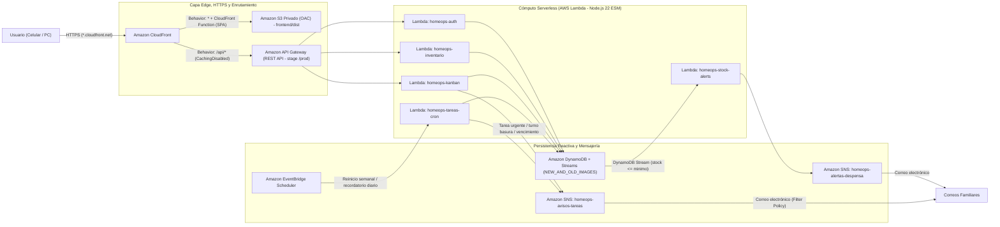

# Plan Maestro de Migración, Reparación y Despliegue: HomeOps / DomusHub (100% Serverless en AWS + CloudFront)

> **Propósito de este documento:** Guía integral paso a paso (migración de código + reparación de bugs reales del repositorio + configuración en Consola AWS + despliegue con AWS CLI) para transformar el repositorio existente **DomusHub** en la plataforma **HomeOps: Sistema de Gestión Doméstica y CRM Familiar** operando sobre una arquitectura **100% Serverless en AWS** con distribución segura mediante **Amazon CloudFront** dentro de la **Capa Gratuita (Free Tier)**.

---

## Tabla de Contenidos

1. [Resumen de la Arquitectura Objetivo (AWS + CloudFront)](#1-resumen-de-la-arquitectura-objetivo-aws--cloudfront)
2. [Auditoría Profunda del Repositorio Actual (Bugs y Brechas Detectadas)](#2-auditoría-profunda-del-repositorio-actual-bugs-y-brechas-detectadas)
3. [Estructura Objetivo del Repositorio](#3-estructura-objetivo-del-repositorio)
4. [Fase 1: Modificación y Migración del Backend para AWS (Node.js 22 Serverless)](#fase-1-modificación-y-migración-del-backend-para-aws-nodejs-22-serverless)
5. [Fase 2: Actualización del Frontend React para AWS y Módulos HomeOps](#fase-2-actualización-del-frontend-react-para-aws-y-módulos-homeops)
6. [Fase 3: Reparación de Bugs, Deuda Técnica y Limpieza del Repositorio Actual](#fase-3-reparación-de-bugs-deuda-técnica-y-limpieza-del-repositorio-actual)
7. [Fase 4: Preparación de Cuenta AWS, Control de Costos, AWS CLI y Roles IAM](#fase-4-preparación-de-cuenta-aws-control-de-costos-aws-cli-y-roles-iam)
8. [Fase 5: Base de Datos NoSQL Reactiva en Amazon DynamoDB + Streams y Seed](#fase-5-base-de-datos-nosql-reactiva-en-amazon-dynamodb--streams-y-seed)
9. [Fase 6: Motor de Notificaciones en Amazon SNS (Pub/Sub + Filter Policies)](#fase-6-motor-de-notificaciones-en-amazon-sns-pubsub--filter-policies)
10. [Fase 7: Creación, Configuración y Subida de las 5 Funciones AWS Lambda](#fase-7-creación-configuración-y-subida-de-las-5-funciones-aws-lambda)
11. [Fase 8: Exposición de la API con Amazon API Gateway (REST API + CORS)](#fase-8-exposición-de-la-api-con-amazon-api-gateway-rest-api--cors)
12. [Fase 9: Alojamiento en Amazon S3 Privado + Amazon CloudFront (OAC + Dual Origin + SPA)](#fase-9-alojamiento-en-amazon-s3-privado--amazon-cloudfront-oac--dual-origin--spa)
13. [Fase 10: Scripts de Despliegue Continuo (AWS CLI) y EventBridge Scheduler](#fase-10-scripts-de-despliegue-continuo-aws-cli-y-eventbridge-scheduler)
14. [Fase 11: Plan de Pruebas End-to-End, Monitoreo en CloudWatch y Solución de Errores](#fase-11-plan-de-pruebas-end-to-end-monitoreo-en-cloudwatch-y-solución-de-errores)

---

## 1. Resumen de la Arquitectura Objetivo (AWS + CloudFront)

La plataforma opera sobre **6 servicios principales de AWS** (los 5 definidos en la propuesta técnica + **Amazon CloudFront** como capa CDN/HTTPS unificada):



### ¿Por qué usar Amazon CloudFront frente a S3 Static Website Hosting directo?

| Aspecto | S3 Static Website Hosting (Solo S3) | S3 Privado + CloudFront (OAC) — **Elegido** |
| :--- | :--- | :--- |
| **HTTPS (SSL/TLS)** | Solo HTTP (inseguro para contraseñas, PIN y JWT) | **HTTPS gratis automático** en `https://<id>.cloudfront.net` |
| **Seguridad del Bucket** | El bucket debe ser 100% público | **Bucket 100% privado** (`Block all public access` activado) vía **OAC** |
| **Rutas SPA (React Router)** | Requiere trucos de Error Document (devuelve HTTP 404 en consola) | **CloudFront Function** reescribe `/kanban`, `/inventario` a `/index.html` con HTTP 200 real |
| **CORS con el Backend** | Dominios distintos (S3 vs API Gateway), obliga preflight `OPTIONS` | **Mismo origen** (`/api/*` enrutado por CloudFront a API Gateway): el frontend mantiene `baseURL: '/api'` |
| **Costo en tráfico doméstico** | Costo bajo / Free Tier 12 meses | **Always Free Tier**: 1 TB salida + 10M requests/mes + 2M CloudFront Functions/mes |

### Los 3 Flujos Arquitectónicos del Sistema

1. **Flujo Síncrono (Uso de la App, Inventario y Kanban):** El navegador carga React desde **CloudFront → S3**. Al mover una tarjeta, iniciar sesión o registrar una compra, React hace una petición HTTPS al mismo dominio (`/api/...`), **CloudFront** la reenvía sin caché a **API Gateway**, este invoca la **Lambda** correspondiente en Node.js 22 y persiste/consulta en **DynamoDB**.
2. **Flujo Asíncrono Orientado a Eventos (Alerta Automática del Súper):** Al descontar stock en la cocina, el registro en `homeops-productos` (**DynamoDB**) cambia. **DynamoDB Streams (`NEW_AND_OLD_IMAGES`)** detecta automáticamente la modificación y dispara la Lambda `homeops-stock-alerts`. Si `cantidad_actual <= cantidad_minima`, construye `"Atención: Queda solo X <unidad> de <Producto>"` y publica en **Amazon SNS (`homeops-alertas-despensa`)**, enviando el correo a la familia sin que nadie presione ningún botón.
3. **Flujo de Avisos de Tareas Domésticas y Turnos de Basura:** Al asignar/crear una tarea **Urgente** o de **Turno de Basura**, o al abrir el tablero Kanban y evaluar tareas pendientes que vencen hoy, la Lambda `homeops-kanban` (y el respaldo programado en `homeops-tareas-cron`) publica en **Amazon SNS (`homeops-avisos-tareas`)** con atributo de filtro para mandar recordatorio directo por correo al responsable.

### Presupuesto 100% Free Tier (Región Única Recomendada: `us-east-1`)

| Servicio AWS | Límite Free Tier | Tipo | Uso estimado (1 hogar) |
| :--- | :--- | :--- | :--- |
| **Amazon CloudFront** | 1 TB salida + 10M requests + 2M Functions / mes | Always Free | < 1 GB y < 10,000 requests/mes |
| **Amazon S3** | 5 GB almacenamiento + 20,000 GET + 2,000 PUT | 12 meses (~$0.01 después) | < 5 MB |
| **Amazon API Gateway** | 1M llamadas REST API / mes | 12 meses (~$0.01 después) | < 5,000 llamadas/mes |
| **AWS Lambda** | 1M invocaciones + 400,000 GB-seg / mes | Always Free | < 10,000 invocaciones/mes |
| **Amazon DynamoDB** | 25 GB + 25 RCU + 25 WCU + 2.5M lecturas Streams | Always Free | < 10 MB, 19 RCU / 19 WCU configurados |
| **Amazon SNS** | 1,000 correos electrónicos / mes | Always Free | ~50–150 correos/mes |
| **Amazon EventBridge Scheduler** | 14 millones de ejecuciones / mes | Always Free | ~35 ejecuciones/mes |

---

## 2. Auditoría Profunda del Repositorio Actual (Bugs y Brechas Detectadas)

Al revisar línea por línea todos los archivos de `backend/` y `frontend/`, se detectaron **8 problemas reales en el código actual** (que se reparan en la **Fase 3**) además de las brechas necesarias para cumplir la propuesta **HomeOps en AWS** (cubiertas en las **Fases 1 y 2**):

### A. Defectos y Bugs Reales Encontrados en el Código Actual

| # | Severidad | Archivo(s) y Líneas Exactas | Problema Detectado | Fase que lo repara |
| :-: | :--- | :--- | :--- | :--- |
| **1** | **Crítico** | `backend/src/Controllers/InventarioController.php` (L25–42), `frontend/src/views/InventarioView.jsx` (L32–33, L129, L197) | **Contradicción en stock crítico:** Cuando `cantidad_actual === cantidad_minima` (ej. 1 L de leche con mínimo 1 L), la fórmula `ratio = actual / minima = 1.0` asigna **`porcentaje_visual = 100%` (verde)**, pero `/inventario/critico` sí lo devuelve como crítico (`actual <= minima`). Así, el producto aparece en rojo en *Modo Supermercado* con badge `100%` y desaparece de la pestaña `⚠ Crítico` en *Despensa*. | **Fase 1 y Fase 3** |
| **2** | **Crítico** | `frontend/src/index.css` (L35–39, L234–240), `frontend/src/components/ui/Modal.jsx` (L30–38) | **Modales desalineados y posible crash:** El reset global `*, *::before, *::after { margin: 0; }` anula el `margin: auto` nativo de `<dialog>`, pegando todos los modales a la esquina superior izquierda. Además, `Modal.jsx` llama `dialog.showModal()` y `dialog.close()` sin verificar `dialog.open`, lo que lanza `InvalidStateError` bajo React StrictMode o re-renders. | **Fase 3** |
| **3** | **Crítico** | `frontend/src/hooks/useModoSuper.js` (L66–83), `frontend/src/stores/inventarioStore.js` (L9–14), `frontend/src/views/ModoSuperView.jsx` (L19–31) | **Desincronización tras comprar y pérdida de lista manual:** `useInventarioStore` cachea `productos`, pero `useModoSuper.finalizarCompra()` nunca llama `useInventarioStore.getState().fetchProductos(true)`. Tras comprar en el súper, *Despensa* sigue mostrando stock viejo hasta recargar el navegador. Además, la lista `"Agregar manualmente"` (`itemsTemp`) vive solo en `useState` y se borra al cambiar de pestaña. | **Fase 3** |
| **4** | **Crítico** | `frontend/src/components/layout/BottomNav.jsx` (L1–40), `frontend/src/views/LoginView.jsx` (L8–18) | **Sin cerrar sesión en móvil:** `SideNav.jsx` (desktop) tiene botón Logout y avatar de usuario, pero `BottomNav.jsx` (móvil `<768px`) no tiene forma de cerrar sesión ni cambiar de perfil familiar. Además, `LoginView.jsx` no redirige a `/inventario` si el usuario ya está autenticado. | **Fase 2 y Fase 3** |
| **5** | **Alto** | `frontend/src/hooks/useKanban.js` (L32–43, L65–68), `frontend/src/views/KanbanView.jsx` (L130, L295), `frontend/src/components/ui/TareaModal.jsx` (L57, L78, L97), `frontend/src/components/ui/TareaDetallesModal.jsx` (L29, L47, L92, L152), `frontend/src/components/ui/HistorialModal.jsx` (L59) | **Fallos de hooks, ESLint, estado y migración DynamoDB:**<br>• Casts `Number(id)` / `Number(columna_id)` / `Number(asignado_a_user_id)` producirán `NaN` con IDs string de DynamoDB (rompiendo Drag & Drop y filtros).<br>• `TareaDetallesModal.jsx` concatena `+ 'Z'` a fechas, rompiendo timestamps ISO 8601 (`Invalid Date`).<br>• `fetchHistorial` no usa `useCallback` y causa peticiones duplicadas al editar inline.<br>• `moverTarea` no actualiza `columna_nombre` en memoria.<br>• Errores de ESLint reales: `err` sin usar (`TareaDetallesModal.jsx:29`), `i` sin usar (`TareaDetallesModal.jsx:152`) y `currentUserId` faltante en deps (`TareaModal.jsx:57`). | **Fase 2 y Fase 3** |
| **6** | **Medio** | `frontend/src/views/InventarioView.jsx` (L48, L413–437), `frontend/src/views/ModoSuperView.jsx` (L167, L179, L500–519), `frontend/src/components/layout/AppShell.jsx` (L35–46), `frontend/src/views/KanbanView.jsx` (L661–689) | **CSS inyectado roto:** 4 vistas ejecutan `document.head.appendChild(...)` a nivel módulo. Las reglas `.card .actions` (`InventarioView`) y `.qtyBtn` (`ModoSuperView`) nunca se aplican porque los elementos JSX omiten `className="actions"` y `className="qtyBtn"`. | **Fase 3** |
| **7** | **Medio** | `backend/src/Controllers/*.php`, `backend/src/Middleware/JwtMiddleware.php`, `backend/routes/auth.php` | **Defectos en el backend PHP (no replicar en AWS):** Código HTTP inválido **`420`** para errores de validación (debe ser `400`/`422`), clave JWT fallback hardcodeada (`'change-this-to-a-secure-random-string'`), y `ComprasController` sobrescribe `precio_promedio` con el último precio en lugar de promediar. | **Fase 1** |
| **8** | **Bajo** | `frontend/src/hooks/useInventario.js`, `frontend/src/components/ui/Spinner.jsx`, `frontend/src/App.css`, `frontend/src/assets/{hero.png,react.svg,vite.svg}`, `frontend/public/icons.svg`, `frontend/index.html`, `frontend/src/components/ui/ProductoModal.jsx` (L73) | **Código muerto, metadatos y validación de número vacío:** `useInventario.js`, `Spinner.jsx`, `App.css` y assets de plantilla Vite no se usan en ningún lado. `index.html` tiene `lang="en"` y `<title>frontend</title>`. `ProductoModal.jsx` puede enviar `""` en campos numéricos vacíos. | **Fase 2 y Fase 3** |

### B. Brechas Funcionales vs. Propuesta Técnica HomeOps (PDF)

| Módulo del PDF | Qué ya existe en el repo | Qué falta construir |
| :--- | :--- | :--- |
| **Perfiles Familiares y Auth** | Login usuario + contraseña con JWT. | Campo `email` (para SNS), **selección rápida de perfil con PIN de 4 dígitos**, vista de administración de integrantes familiares. |
| **Inventario Inteligente (Súper)** | CRUD, barra visual, filtro Crítico y Modo Supermercado. | Campo **`categoria`** (Lácteos, Limpieza, Despensa, etc.), filtro por categoría, botones rápidos **`-1` / `+1`** en tarjetas para descontar en cocina y disparar DynamoDB Streams. |
| **Kanban y Turnos de Basura** | Columnas dinámicas, Drag & Drop, historial, recurrencia y fecha límite. | Campo **`prioridad`** (`baja`, `media`, `alta`, `urgente`), marca de **`es_turno_basura` (`🗑️`)**, filtro por integrante familiar y disparo automático a SNS. |
| **Motor de Notificaciones (SNS)** | No existe. | Tópicos `homeops-alertas-despensa` y `homeops-avisos-tareas`, Lambda reactiva `homeops-stock-alerts` (DynamoDB Streams) y avisos de tareas/basura con anti-spam. |

---

## 3. Estructura Objetivo del Repositorio

```text
DomusHub/
├── .gitignore
├── plan.md                             # Este documento maestro
├── backend/                            # Nuevo backend Serverless (Node.js 22 ESM)
│   ├── package.json                    # "type": "module" (sin dependencias pesadas)
│   ├── shared/                         # Módulos compartidos empaquetados con cada Lambda
│   │   ├── dynamoClient.mjs            # Cliente DynamoDB DocumentClient (AWS SDK v3)
│   │   ├── snsClient.mjs               # Cliente Amazon SNS (AWS SDK v3)
│   │   ├── jwt.mjs                     # Firma y verificación JWT HS256 (node:crypto)
│   │   ├── password.mjs                # Hash seguro scrypt para passwords y PINs
│   │   └── http.mjs                    # Helpers de respuesta JSON, CORS y parseo body
│   ├── lambdas/
│   │   ├── auth/
│   │   │   └── index.mjs               # Login password, Login PIN, perfiles y CRUD usuarios
│   │   ├── inventario/
│   │   │   └── index.mjs               # CRUD productos, /critico, PATCH stock, compras
│   │   ├── kanban/
│   │   │   └── index.mjs               # Columnas, tareas, mover, historial, avisos SNS
│   │   ├── stock-alerts/
│   │   │   └── index.mjs               # Trigger DynamoDB Streams → SNS Despensa
│   │   └── tareas-cron/
│   │       └── index.mjs               # Trigger EventBridge → Reinicio semanal + avisos
│   └── scripts/
│       └── seed-dynamodb.mjs           # Carga inicial de columnas, admin y datos demo
├── frontend/                           # React 19 + Vite 8 + Tailwind v4 + Zustand (JS)
│   ├── .env.development                # VITE_API_URL=/api (proxy hacia API Gateway)
│   ├── .env.production                 # VITE_API_URL=/api (enrutado por CloudFront)
│   ├── index.html
│   ├── vite.config.js
│   └── src/
│       ├── api/axiosInstance.js
│       ├── components/
│       ├── hooks/
│       ├── stores/
│       ├── utils/dateFormat.js         # Parseo centralizado seguro de fechas ISO 8601
│       └── views/
│           ├── InventarioView.jsx
│           ├── KanbanView.jsx
│           ├── LoginView.jsx
│           ├── ModoSuperView.jsx
│           ├── NotFoundView.jsx
│           ├── PerfilesView.jsx        # [NUEVO] Gestión de integrantes familiares y PIN
│           └── ProductosView.jsx
└── scripts/                            # Automatización de despliegues vía AWS CLI
    ├── deploy-lambdas.sh               # Empaqueta .zip y actualiza las 5 Lambdas
    └── deploy-frontend.sh              # Build Vite + S3 Sync + Invalidación CloudFront
```

---

## Fase 1: Modificación y Migración del Backend para AWS (Node.js 22 Serverless)

En esta fase se reemplaza el backend legacy en Slim PHP + SQLite por las **5 funciones AWS Lambda en Node.js 22 (ESM)** listas para ejecutarse sobre DynamoDB y SNS, corrigiendo además los defectos heredados del backend original.

### Tarea 1.1: Retirar el Backend PHP Legacy y Configurar `backend/package.json`

1. Eliminar los archivos PHP/SQLite obsoletos dentro de `backend/`:
   - `backend/composer.json`, `backend/composer.lock`, `backend/database.sql`, `backend/config/`, `backend/cron/`, `backend/public/`, `backend/routes/`, `backend/scripts/seed.php`, `backend/src/`.
2. Actualizar `.gitignore` en la raíz del repositorio:
   ```gitignore
   # Dependencies
   node_modules/

   # Environment
   .env
   .env.*
   !.env.example

   # Build & AWS Lambda packages
   frontend/dist/
   backend/dist/
   *.zip

   # IDE
   .idea/
   .vscode/
   *.swp
   *.swo
   ```
3. Crear `backend/package.json`:
   ```json
   {
     "name": "homeops-backend",
     "version": "1.0.0",
     "private": true,
     "type": "module",
     "scripts": {
       "seed": "node scripts/seed-dynamodb.mjs"
     },
     "devDependencies": {
       "@aws-sdk/client-dynamodb": "^3.700.0",
       "@aws-sdk/lib-dynamodb": "^3.700.0"
     }
   }
   ```
   > **Por qué cero `dependencies` de producción:** El runtime **Node.js 22** en AWS Lambda ya trae preinstalado el AWS SDK v3 (`@aws-sdk/client-dynamodb`, `@aws-sdk/lib-dynamodb`, `@aws-sdk/client-sns`) y el módulo nativo `node:crypto`. Usando `node:crypto` para JWT HS256 y hashing `scrypt`, cada paquete `.zip` pesará **< 15 KB** sin problemas de binarios compilados entre Linux/macOS/ARM64. (`devDependencies` solo se usa localmente para ejecutar `seed-dynamodb.mjs`).

### Tarea 1.2: Crear los Módulos Compartidos (`backend/shared/`)

Crea los 5 archivos base que compartirán las Lambdas:

1. **`backend/shared/dynamoClient.mjs`** — Instancia singleton de `DynamoDBDocumentClient` con `marshallOptions: { removeUndefinedValues: true }`.
2. **`backend/shared/snsClient.mjs`** — Cliente `SNSClient` y helper `publishNotification({ topicArn, subject, message, destinatario })` que envía `MessageAttributes` (`destinatario`) cuando se publica en `homeops-avisos-tareas`.
3. **`backend/shared/password.mjs`** — Funciones `hashSecret(plain)` y `verifySecret(plain, stored)` usando `crypto.scryptSync` + `salt` de 16 bytes + `crypto.timingSafeEqual` (sirve tanto para contraseñas como para PIN de 4 dígitos).
4. **`backend/shared/jwt.mjs`** — Implementación HS256 con `crypto.createHmac('sha256', secret)` + validación de `exp` y helper `authenticateRequest(event)`:
   - **Corrección de seguridad respecto al backend PHP:** Si `process.env.JWT_SECRET` no está definido, lanzar error explícito (`500`) — **nunca** usar una clave por defecto hardcodeada.
   - Leer el header de forma insensible a mayúsculas: `event.headers?.authorization || event.headers?.Authorization`.
5. **`backend/shared/http.mjs`** — Helpers `jsonResponse(statusCode, body)`, `parseBody(event)` (validando JSON malformado con `400 Bad Request`) y respuesta `204` para preflight `OPTIONS`:
   - **Corrección respecto al backend PHP:** Todos los errores de validación devuelven **`400`** o **`422`** (nunca el código no estándar `420`).
   ```javascript
   export function jsonResponse(statusCode, body) {
     return {
       statusCode,
       headers: {
         'Content-Type': 'application/json; charset=utf-8',
         'Access-Control-Allow-Origin': process.env.CORS_ORIGIN || '*',
         'Access-Control-Allow-Headers': 'Content-Type,Authorization',
         'Access-Control-Allow-Methods': 'GET,POST,PUT,PATCH,DELETE,OPTIONS',
       },
       body: JSON.stringify(body),
     };
   }
   ```

### Tarea 1.3: Implementar las 5 Funciones AWS Lambda (`backend/lambdas/`)

#### 1. `backend/lambdas/auth/index.mjs` (`homeops-auth`)
Rutas gestionadas:
- `GET /api/auth/perfiles` *(público)*: retorna lista segura `{ id, nombre, rol, avatar_color, tiene_pin }` para el selector visual de acceso rápido con PIN (omite `password_hash`, `pin_hash` y `email`).
- `POST /api/auth/login` *(público)*: valida `{ nombre, password }` contra `homeops-usuarios` usando el GSI `nombre-index` y emite JWT HS256 `{ sub: user.id, nombre, rol }`.
- `POST /api/auth/login-pin` *(público)*: valida `{ user_id, pin }` (4 dígitos) contra `pin_hash` y emite el mismo JWT HS256.
- `GET /api/protected/health` *(JWT)*: health check `{ status: 'ok', user_id, timestamp }`.
- `GET /api/protected/usuarios` *(JWT)*: lista integrantes `{ id, nombre, email, rol, avatar_color, tiene_pin }`.
- `POST /api/protected/usuarios` *(JWT — `admin`)*: crea nuevo perfil familiar (`nombre`, `email`, `rol`, `password`, `pin` opcional de 4 dígitos, `avatar_color`). Verifica unicidad de `nombre` vía `nombre-index`.
- `PUT /api/protected/usuarios/{id}` y `DELETE /api/protected/usuarios/{id}` *(JWT — `admin`)*: edita perfil/PIN/email o elimina un integrante (impidiendo eliminar el propio usuario en sesión).

#### 2. `backend/lambdas/inventario/index.mjs` (`homeops-inventario`)
> **Corrección crítica de la fórmula `calcularPorcentajeVisual(actual, minima)`:**
> En el backend PHP anterior, cuando `cantidad_actual === cantidad_minima` devolvía `100%` verde. La nueva fórmula alinea 100% el porcentaje visual con el umbral de alerta crítica y DynamoDB Streams:
> ```javascript
> export function calcularPorcentajeVisual(cantidadActual, cantidadMinima) {
>   if (cantidadActual <= 0) return 0;
>   if (cantidadMinima <= 0) return 100;
>   if (cantidadActual <= cantidadMinima) return 25;        // Crítico (rojo) — coincide con alerta SNS
>   if (cantidadActual <= cantidadMinima * 2) return 50;    // Medio (amarillo)
>   if (cantidadActual <= cantidadMinima * 3) return 75;    // Bueno (verde)
>   return 100;                                             // Óptimo (verde)
> }
> ```

Rutas protegidas con JWT:
- `GET /api/protected/inventario`: retorna `{ data, total }` ordenado por `nombre`. Soporta filtro `?categoria=Lácteos`.
- `GET /api/protected/inventario/critico`: filtra `cantidad_actual <= cantidad_minima || porcentaje_visual <= 25`, retorna `{ data, total }`.
- `POST /api/protected/inventario`: crea producto con `id = 'prod_' + crypto.randomUUID().slice(0, 8)`, `nombre`, `categoria` (default `'Despensa'`), `cantidad_actual`, `unidad_medida`, `cantidad_minima`, `precio_promedio`, `porcentaje_visual` y `actualizado_por`.
- `PUT /api/protected/inventario/{id}`: actualiza producto completo y recalcula `porcentaje_visual`.
- `PATCH /api/protected/inventario/{id}/stock`: descuento/incremento rápido desde la cocina (`{ delta: -1 }` o `{ cantidad_actual: 1 }`), limita mínimo a `0`, recalcula `porcentaje_visual` y guarda `actualizado_por` *(esta escritura dispara DynamoDB Streams → SNS)*.
- `DELETE /api/protected/inventario/{id}`: elimina el producto.
- `POST /api/protected/compras/registrar`: recibe `{ items: [{ id_producto, precio_pagado, cantidad_comprada }] }`, valida todos los productos y ejecuta `TransactWriteCommand`:
  - Suma `cantidad_comprada` a `cantidad_actual`.
  - Recalcula `porcentaje_visual` con la nueva fórmula (en vez de forzar `100` a ciegas si compraron menos del umbral ideal).
  - **Corrección de precio promedio:** si ya existía un `precio_promedio > 0`, calcula el promedio ponderado/móvil `Math.round(((anterior + precio_pagado) / 2) * 100) / 100` (o usa `precio_pagado` si era `0`).

#### 3. `backend/lambdas/kanban/index.mjs` (`homeops-kanban`)
Rutas protegidas con JWT:
- **Columnas:** `GET /api/protected/kanban/columnas` (ordenadas por `posicion ASC`), `POST /api/protected/kanban/columnas`, `DELETE /api/protected/kanban/columnas/{id}`.
- **Tareas:**
  - `GET /api/protected/kanban/tareas`: lee tareas, columnas y usuarios, enriquece con `asignado_nombre` y `columna_nombre`, y ordena por `fecha_creacion DESC`.
  - `POST /api/protected/kanban/tareas`: crea tarea con `titulo`, `descripcion`, `columna_id`, `asignado_a_user_id`, `prioridad` (`baja`|`media`|`alta`|`urgente`), `es_recurrente` (`0`|`1`), `es_turno_basura` (`0`|`1`), `fecha_vencimiento`. Inserta `"Tarea creada"` en `homeops-tareas-historial`.
    - **Disparo inmediato SNS (Flujo 4.3):** Si `prioridad === 'urgente'` o `es_turno_basura === 1`, publica inmediatamente en `SNS_TAREAS_TOPIC_ARN` con `destinatario = asignado_a_user_id || 'familia'` y guarda `ultima_alerta_fecha = hoyISO`.
  - `PUT /api/protected/kanban/tareas/{id}`: actualiza tarea, registra `"Tarea modificada"` en historial y dispara SNS si pasa a urgente/basura o cambia de responsable siendo urgente.
  - `PUT` / `PATCH /api/protected/kanban/tareas/{id}/mover`: actualiza `columna_id` y guarda en `homeops-tareas-historial` el evento `'Movido de "<Origen>" a "<Destino>"'` con `user_id` y `usuario_nombre`. Devuelve `{ message, columna_anterior, columna_nueva, tarea }`.
  - `DELETE /api/protected/kanban/tareas/{id}`: elimina la tarea y su historial asociado.
  - `GET /api/protected/kanban/tareas/{id}/historial`: ejecuta `QueryCommand` en `homeops-tareas-historial` (`KeyConditionExpression: 'tarea_id = :tid'`, `ScanIndexForward: false`).
  - `POST /api/protected/kanban/evaluar-avisos`: identifica la columna final ("Completado"), busca tareas activas cuya `fecha_vencimiento <= hoy` o `es_turno_basura === 1` para hoy con `ultima_alerta_fecha !== hoy` (anti-spam diario), publica recordatorio en `SNS_TAREAS_TOPIC_ARN` y marca `ultima_alerta_fecha = hoy`.

#### 4. `backend/lambdas/stock-alerts/index.mjs` (`homeops-stock-alerts`)
Lambda reactiva disparada por **DynamoDB Streams** de `homeops-productos` (**Flujo 4.2 del PDF**):

```javascript
import { SNSClient, PublishCommand } from '@aws-sdk/client-sns';

const sns = new SNSClient({});
const TOPIC_ARN = process.env.SNS_DESPENSA_TOPIC_ARN;

export const handler = async (event) => {
  for (const record of event.Records || []) {
    if (record.eventName !== 'MODIFY' && record.eventName !== 'INSERT') continue;

    const newImg = record.dynamodb?.NewImage;
    const oldImg = record.dynamodb?.OldImage;
    if (!newImg) continue;

    const nombre = newImg.nombre?.S || 'Producto';
    const categoria = newImg.categoria?.S || 'Despensa';
    const unidad = newImg.unidad_medida?.S || 'unidad(es)';
    const nuevaCant = Number(newImg.cantidad_actual?.N ?? 0);
    const minimo = Number(newImg.cantidad_minima?.N ?? 0);

    const cantAnterior = oldImg ? Number(oldImg.cantidad_actual?.N ?? Infinity) : Infinity;
    const minimoAnterior = oldImg ? Number(oldImg.cantidad_minima?.N ?? 0) : 0;

    // Anti-spam: alertar solo si está en umbral crítico Y acaba de disminuir o cruzar el mínimo
    const estaCritico = nuevaCant <= minimo;
    const bajoCantidad = nuevaCant < cantAnterior;
    const cruzoUmbral = cantAnterior > minimoAnterior && estaCritico;

    if (estaCritico && (bajoCantidad || cruzoUmbral || record.eventName === 'INSERT')) {
      const textoCantidad = nuevaCant === 0
        ? `¡Se agotó ${nombre}! (0 ${unidad})`
        : `Atención: Queda solo ${nuevaCant} ${unidad} de ${nombre}`;

      const mensaje = [
        textoCantidad,
        `Categoría: ${categoria}`,
        `Umbral mínimo configurado: ${minimo} ${unidad}`,
        '',
        'Revisa el Modo Supermercado en HomeOps para agregarlo a la próxima compra.',
      ].join('\n');

      await sns.send(new PublishCommand({
        TopicArn: TOPIC_ARN,
        Subject: `[HomeOps Alerta Súper] Stock bajo: ${nombre}`,
        Message: mensaje,
      }));

      console.log(`Alerta SNS enviada para ${nombre} (actual=${nuevaCant}, min=${minimo})`);
    }
  }
  return { statusCode: 200 };
};
```

#### 5. `backend/lambdas/tareas-cron/index.mjs` (`homeops-tareas-cron`)
Reemplaza `backend/cron/reiniciar_tareas.php` mediante **EventBridge Scheduler**:
- `{ action: "reiniciar_recurrentes" }` (lunes 00:01 AM): regresa tareas con `es_recurrente === 1` a la primera columna (`Por hacer`), limpia `ultima_alerta_fecha` y escribe el registro en `homeops-tareas-historial`.
- `{ action: "recordatorio_diario" }` (diario 08:00 AM): revisa tareas pendientes que vencen hoy o son turno de basura del día y envía avisos vía SNS.

### Tarea 1.4: Crear Script Seed para DynamoDB (`backend/scripts/seed-dynamodb.mjs`)

Crea `backend/scripts/seed-dynamodb.mjs` idempotente (no sobrescribe usuarios existentes) que cargará los datos iniciales en la **Fase 5**:
- 3 columnas base: `col_1` (`Por hacer`, pos `1`), `col_2` (`En progreso`, pos `2`), `col_3` (`Completado`, pos `3`).
- Usuario administrador inicial `usr_admin` (`nombre: "admin"`, contraseña temporal `admin123`, PIN `1234`, `rol: "admin"`, email configurable con `SEED_ADMIN_EMAIL`).
- 3 productos de ejemplo (`Leche Entera` en `Lácteos`, `Papel Higiénico` en `Limpieza`, `Arroz` en `Despensa`) y 1 tarea recurrente de ejemplo (`Sacar la basura`, `es_turno_basura: 1`, `prioridad: "urgente"`).

---

## Fase 2: Actualización del Frontend React para AWS y Módulos HomeOps

En esta fase se adapta el frontend React existente (`frontend/`) para hablar con CloudFront/API Gateway + DynamoDB y se añaden las funcionalidades de la propuesta técnica que todavía no existían.

### Tarea 2.1: Variables de Entorno, Cliente Axios, Proxy Vite y Metadatos

1. Actualizar `.gitignore` en la raíz para permitir versionar `.env.development` y `.env.production` (manteniendo ignorados `.env` y `*.local`):
   ```gitignore
   .env
   .env.*
   !.env.example
   !.env.development
   !.env.production
   *.local
   ```
2. Crear `frontend/.env.development`:
   ```env
   VITE_API_URL=/api
   # Opcional para desarrollar contra tu API Gateway desplegado:
   # VITE_DEV_PROXY_TARGET=https://<api-id>.execute-api.us-east-1.amazonaws.com/prod
   ```
3. Crear `frontend/.env.production`:
   ```env
   VITE_API_URL=/api
   ```
   *(En producción, CloudFront enruta `https://<id>.cloudfront.net/api/*` hacia API Gateway bajo el mismo origen).*
4. Actualizar `frontend/src/api/axiosInstance.js` (ignorando `401` en rutas públicas `/auth/login`, `/auth/login-pin` y `/auth/perfiles` para no disparar `logout()` innecesario):
   ```javascript
   const api = axios.create({
     baseURL: import.meta.env.VITE_API_URL || '/api',
     timeout: 15000,
   })
   ```
5. Actualizar `frontend/vite.config.js` para que el proxy local `/api` lea `VITE_DEV_PROXY_TARGET` (por defecto apunta a tu API Gateway `prod` o servidor local):
   ```javascript
   import { defineConfig, loadEnv } from 'vite'
   import react from '@vitejs/plugin-react'
   import tailwindcss from '@tailwindcss/vite'

   export default defineConfig(({ mode }) => {
     const env = loadEnv(mode, process.cwd(), '')
     return {
       plugins: [react(), tailwindcss()],
       server: {
         proxy: {
           '/api': {
             target: env.VITE_DEV_PROXY_TARGET || 'http://localhost:3000',
             changeOrigin: true,
           },
         },
       },
     }
   })
   ```
6. Actualizar `frontend/index.html`: cambiar `lang="en"` → `lang="es"`, `<title>frontend</title>` → `<title>HomeOps — Gestión Doméstica</title>`, añadir atributos del sistema de diseño (`data-type="software" data-radius="soft" data-buttons="solid" data-motion`) y cargar las fuentes sorteadas (`Reddit Sans` y `JetBrains Mono`).

### Tarea 2.2: Compatibilidad de IDs String y Fechas ISO 8601 (SQLite → DynamoDB)

En DynamoDB los identificadores son strings (`usr_admin`, `col_1`, `prod_a1b2`, `task_9f8e`) y los timestamps son ISO 8601 (`2026-11-22T19:00:00.000Z`). Aplicar estos cambios exactos:

1. **`frontend/src/hooks/useKanban.js` (L32–43):**
   - Quitar `Number(nuevaColumnaId)` y `Number(tareaId)`.
   - Enviar `{ columna_id: String(nuevaColumnaId) }` y comparar `String(t.id) === String(tareaId)`.
2. **`frontend/src/views/KanbanView.jsx` (L130, L295):**
   - En `handleDrop` (L130): cambiar `onMover(Number(tareaId), columna.id)` por `onMover(tareaId, columna.id)`.
   - En `tareasFiltradas` (L295): cambiar `Number(t.asignado_a_user_id) === Number(userId)` por `String(t.asignado_a_user_id) === String(userId)`.
3. **`frontend/src/components/ui/TareaModal.jsx` (L78, L97):**
   - En `handleChange` (L78): eliminar el cast `name === 'columna_id' ? Number(value) : value`.
   - En `handleSubmit` (L97): cambiar `Number(form.asignado_a_user_id)` por `form.asignado_a_user_id || null`.
4. **`frontend/src/components/ui/TareaDetallesModal.jsx` (L92):**
   - Cambiar `e.target.value ? Number(e.target.value) : null` por `e.target.value || null`.
5. **Crear `frontend/src/utils/dateFormat.js`** y usarlo en `TareaDetallesModal.jsx` (L45–49) e `HistorialModal.jsx` (L55–69):
   ```javascript
   export function formatFechaHistorial(dateStr) {
     if (!dateStr) return ''
     const clean = String(dateStr).split('#')[0] // Limpia sufijo único del Sort Key en DynamoDB
     const hasTz = /[zZ]$|[+-]\d{2}:\d{2}$/.test(clean)
     const iso = clean.includes('T')
       ? (hasTz ? clean : `${clean}Z`)
       : `${clean.replace(' ', 'T')}Z`
     const date = new Date(iso)
     if (Number.isNaN(date.getTime())) return clean
     return date.toLocaleString('es-MX', {
       day: '2-digit',
       month: 'short',
       hour: 'numeric',
       minute: '2-digit',
       hour12: true,
     })
   }
   ```

### Tarea 2.3: Implementar los Módulos Faltantes de la Propuesta Técnica HomeOps

1. **Módulo de Perfiles Familiares y Acceso Rápido con PIN:**
   - **`frontend/src/views/LoginView.jsx`:** Agregar selector de 2 pestañas y redirección automática a `/inventario` si ya hay sesión activa:
     - **Acceso Rápido (PIN):** carga `GET /api/auth/perfiles`, muestra avatares de los integrantes del hogar, al tocar uno solicita su PIN de 4 dígitos y autentica contra `POST /api/auth/login-pin` (o pre-llena su usuario en la pestaña de contraseña si aún no tiene PIN configurado).
     - **Usuario y Contraseña:** mantiene el formulario actual contra `POST /api/auth/login`.
   - **`frontend/src/views/PerfilesView.jsx` *(nuevo)* + ruta `/perfiles` en `App.jsx`, `SideNav.jsx` y `BottomNav.jsx`:**
     - Permite al `admin` crear, editar y eliminar integrantes del hogar (`nombre`, `email` para alertas SNS, `rol`, `pin` de 4 dígitos con opción de desactivarlo, contraseña y color de avatar sin tonos violeta/lavanda).
     - Sincroniza `useAuthStore.updateUser()` cuando el administrador edita su propio perfil y añade barra superior móvil (`#mobile-topbar` en `AppShell.jsx`) para cambiar de perfil o cerrar sesión en `< 768px`.
     - Muestra aviso claro recordando confirmar el correo de suscripción en Amazon SNS para recibir alertas.
2. **Módulo de Inventario Inteligente con Categorías y Consumo Rápido:**
   - **`frontend/src/components/ui/ProductoModal.jsx`:** Agregar campo `<select name="categoria">` (`Despensa`, `Lácteos`, `Limpieza`, `Frutas y Verduras`, `Carnes y Fríos`, `Higiene`, `Bebidas`, `Otros`), incluir las unidades `L` y `rollo` usadas por `seed-dynamodb.mjs`, y normalizar campos numéricos antes de guardar.
   - **`frontend/src/stores/inventarioStore.js`:** Añadir acción `ajustarStock(id, delta)` que llama a `PATCH /protected/inventario/${id}/stock`, acción `reset()` al cerrar sesión y función unificada `esProductoCritico(p)`.
   - **`frontend/src/views/InventarioView.jsx`, `ProductosView.jsx` y `ModoSuperView.jsx`:**
     - Mostrar badge de `categoria` en cada tarjeta y pills de filtro por categoría.
     - Agregar botones rápidos **`-1`** y **`+1`** en las tarjetas de `InventarioView.jsx` para descontar productos desde la cocina en 1 clic (detona automáticamente DynamoDB Streams → SNS al llegar al mínimo).
     - Añadir eliminación con modal de confirmación en `ProductosView.jsx` y sincronización de `useInventarioStore` + persistencia en `localStorage` (`homeops-lista-manual`) en `ModoSuperView.jsx`.
3. **Tablero Kanban con Prioridad, Turnos de Basura, Gestión de Columnas y Avisos SNS:**
   - **`frontend/src/components/ui/TareaModal.jsx` y `TareaDetallesModal.jsx`:**
     - Añadir selector de **`prioridad`** (`baja`, `media`, `alta`, `urgente`).
     - Añadir checkbox **`Turno de recolección de basura 🗑️`** (`es_turno_basura`) y refrescar el historial tras editar campos inline en `TareaDetallesModal.jsx`.
   - **`frontend/src/hooks/useKanban.js` y `frontend/src/views/KanbanView.jsx`:**
     - Mostrar badge visual de `prioridad` y etiqueta `🗑️ Basura` en las tarjetas, e incluir `prioridad` y `es_turno_basura` en `handleUpdateTaskField`.
     - Añadir `crearColumna` (`POST /api/protected/kanban/columnas`) y `eliminarColumna` (`DELETE /api/protected/kanban/columnas/{id}`) con modales en `KanbanView.jsx`.
     - Añadir filtros rápidos por integrante familiar, filtro `🗑️ Turnos basura`, además de `Ver todo`, `Mis tareas` y días `Lun–Dom`.
     - Invocar `POST /api/protected/kanban/evaluar-avisos` al entrar al tablero (una vez por sesión en `sessionStorage`) y mediante botón manual `"Avisos del día"` mostrando un toast si SNS notificó tareas pendientes/turnos de basura.

### Tarea 2.4: Aplicar el Sistema de Diseño `design-taste-frontend` (`tasteskill 2.5.1`)

1. **Paleta y Tipografía Sorteadas (`frontend/.taste-skill/history.json`):**
   - Aplicar los tokens de `white-navy-tab` (`--p-*`, acento `#f7941d` con contraste de tinta oscura `#111417` > 8:1 en botones primarios) y las fuentes `Reddit Sans` (display/texto) + `JetBrains Mono` (`tabular-nums` en cantidades, precios, porcentajes, fechas y PIN de 4 dígitos).
   - Cero tonos violeta o lavanda en toda la interfaz y en los selectores de avatar (`#2a9d8f`, `#e76f51`, `#f4a261`, `#457b9d`, `#6a994e`, `#e9c46a`).
2. **Superficies, Bordes y Micro-interacciones (`system.md`, `cards.md`, `motion.md`):**
   - Superficies sólidas de un paso (`--color-bg: #090b10`, `--color-surface: #12151e`, `--color-surface2: #181c27`) con bordes hairline `1px` (`rgba(255,255,255,0.11)`) sin glassmorphism ni sombras neón.
   - Radio `soft` (`8px` controles/botones, `12px` tarjetas, `20px` modales), botones con altura mínima táctil de `44px`, elevación `2px` en tarjetas interactivas y micro-interacción `1px` step / `0.985` press con curva `cubic-bezier(0.2, 0.8, 0.2, 1)`.

---

## Fase 3: Reparación de Bugs, Deuda Técnica y Limpieza del Repositorio Actual

Esta fase corrige **todos los defectos confirmados en nuestra auditoría profunda del repositorio actual** antes de compilar y desplegar en AWS.

### Tarea 3.1: Reparar Modales `<dialog>` (Centrado CSS + Excepción `InvalidStateError`)

1. **`frontend/src/index.css` (L234–240):** Añadir **`margin: auto;`** en la regla `dialog` para contrarrestar el reset global `*, *::before, *::after { margin: 0; }` de la línea 35:
   ```css
   dialog {
     border: none;
     background: none;
     padding: 0;
     margin: auto;
     max-width: 90vw;
     width: 420px;
   }
   ```
2. **`frontend/src/components/ui/Modal.jsx` (L30–38):** Proteger las llamadas nativas comprobando `dialog.open`:
   ```javascript
   useEffect(() => {
     const dialog = dialogRef.current
     if (!dialog) return
     if (isOpen) {
       if (!dialog.open) dialog.showModal()
     } else {
       if (dialog.open) dialog.close()
     }
   }, [isOpen])
   ```

### Tarea 3.2: Reparar Regla de Stock Crítico y Sincronización `ModoSuperView` ↔ `inventarioStore`

1. **`frontend/src/views/InventarioView.jsx` (L32–33, L129, L197):** Unificar la condición de producto crítico en una sola función auxiliar `esCritico(p)` para que nunca contradiga a `ModoSuperView`:
   ```javascript
   const esCritico = (p) =>
     Number(p.porcentaje_visual) <= 25 ||
     Number(p.cantidad_actual) <= Number(p.cantidad_minima)
   ```
2. **`frontend/src/hooks/useModoSuper.js` (L66–83):** Después de completar `POST /protected/compras/registrar`, invalidar y refrescar el store global del inventario:
   ```javascript
   import { useInventarioStore } from '../stores/inventarioStore'
   // Dentro de finalizarCompra(), tras api.post('/protected/compras/registrar', { items }):
   await Promise.all([
     fetchCriticos(),
     useInventarioStore.getState().fetchProductos(true),
   ])
   ```
3. **`frontend/src/views/ModoSuperView.jsx` (L19–31):** Persistir los artículos manuales (`itemsTemp`) en `localStorage` bajo la clave `'homeops-lista-manual'` para que no se pierdan al cambiar de vista o bloquear el celular en el supermercado.
4. **`frontend/src/components/ui/ProductoModal.jsx` (L77–95):** Normalizar valores numéricos antes de llamar `onSave(form)` (`Number(form.cantidad_actual) || 0`, `Number(form.cantidad_minima) || 0`, `Number(form.precio_promedio) || 0`) para evitar enviar cadenas vacías `""`.

### Tarea 3.3: Reparar Flujo de Sesión en Móvil y Protección de `/login`

1. **Cerrar sesión y usuario activo en móvil (`frontend/src/components/layout/AppShell.jsx` y `BottomNav.jsx`):**
   - Agregar una barra superior compacta visible solo en móvil (`< 768px`) con el logo **HomeOps**, el avatar/nombre del integrante activo y el botón de **Cerrar sesión** (reutilizando `useAuthStore().logout()` y limpiando el estado de `useInventarioStore`).
2. **`frontend/src/stores/inventarioStore.js`:** Añadir método `reset: () => set({ productos: [], loading: true, error: null })` e invocarlo al hacer `logout()` para no arrastrar estados/errores entre sesiones de distintos familiares.
3. **`frontend/src/views/LoginView.jsx`:** Al inicio del componente, comprobar `const token = useAuthStore((s) => s.token)` y si ya hay token activo retornar `<Navigate to="/inventario" replace />`.

### Tarea 3.4: Reparar Hooks, Errores de ESLint y Estado en Kanban

1. **`frontend/src/hooks/useKanban.js`:**
   - Envolver `fetchHistorial` en `useCallback(async (tareaId) => { ... }, [])` para eliminar recargas infinitas/redundantes en `TareaDetallesModal.jsx` e `HistorialModal.jsx`.
   - En `moverTarea`, actualizar también `columna_nombre` buscando la columna destino en `columnas`, para que al abrir `TareaDetallesModal` muestre inmediatamente la nueva columna.
2. **`frontend/src/components/ui/TareaDetallesModal.jsx`:**
   - Línea 29: cambiar `} catch (err) {` por `} catch {` (corrige error ESLint `no-unused-vars`).
   - Línea 152: cambiar `historial.map((h, i) => (` por `historial.map((h) => (` (corrige error ESLint `no-unused-vars`).
3. **`frontend/src/components/ui/TareaModal.jsx`:**
   - Línea 57: agregar `currentUserId` al array de dependencias del `useEffect` (`[isOpen, tarea, columnaInicial, columnas, currentUserId]`), y reemplazar el `const sync = async () => ...` por un reset limpio controlado al abrir el modal o `key={modalKey}` desde `KanbanView`.
4. **`frontend/src/views/ProductosView.jsx`:** Añadir botón de eliminar producto con `Modal` de confirmación (actualmente solo permitía editar desde el catálogo).

### Tarea 3.5: Consolidar CSS Roto y Eliminar Código Muerto / Basura de Vite

1. **Mover estilos inyectados dinámicamente a `frontend/src/index.css`:**
   - Eliminar los 4 bloques `document.head.appendChild(...)` al final de `AppShell.jsx` (L35–46), `InventarioView.jsx` (L413–437), `KanbanView.jsx` (L661–689) y `ModoSuperView.jsx` (L500–519) y consolidar esas reglas directamente en `frontend/src/index.css`.
   - Agregar `className="actions"` en `<div style={styles.actions}>` de `InventarioView.jsx` (L48) y `className="qtyBtn"` en los botones `+`/`-` de `ModoSuperView.jsx` (L167 y L179) para que sus estilos hover/disabled funcionen de verdad.
   - Corregir el selector `.card .actions button:last-child:hover` en `InventarioView` por una clase dedicada `.action-btn-danger:hover` para que no choque con los badges `<span>`.
2. **Eliminar archivos muertos y restos del template de Vite:**
   - Eliminar `frontend/src/hooks/useInventario.js` (reemplazado por `stores/inventarioStore.js`, sin referencias).
   - Eliminar `frontend/src/App.css` (vacío, sin referencias).
   - Eliminar `frontend/src/assets/hero.png`, `frontend/src/assets/react.svg`, `frontend/src/assets/vite.svg` y `frontend/public/icons.svg` (no se usan; evita subir basura a S3).
   - Evaluar `frontend/src/components/ui/Spinner.jsx`: reutilizarlo en los botones/modales de carga (en vez de duplicar `spinnerInline` 5 veces) o eliminarlo si no se usa.

### Tarea 3.6: Validación Local de Calidad Antes de Subir a AWS

```bash
cd /home/fer/DomusHub/frontend
npm install
npm run lint    # Debe finalizar con 0 errores y 0 warnings
npm run build   # Debe generar frontend/dist/ limpiamente
```

---

## Fase 4: Preparación de Cuenta AWS, Control de Costos, AWS CLI y Roles IAM

Con el código del backend y frontend ya preparados y reparados localmente, comenzamos la configuración paso a paso en AWS.

> **Regla de Oro:** Selecciona siempre la misma región en la esquina superior derecha de la Consola AWS: **`US East (N. Virginia) us-east-1`**.

### Tarea 4.1: Proteger la Cuenta AWS con Alerta de Presupuesto (Free Tier)

1. Inicia sesión en la **Consola de AWS** (`https://console.aws.amazon.com`) y selecciona región **`us-east-1`**.
2. Busca **Billing and Cost Management** → menú izquierdo **Budgets** → **Create budget**.
3. Elige **Use a template (simplified)** → **Zero spend budget**.
4. Configura **Budget name:** `HomeOps-ZeroSpend-Alert` y **Email recipients:** tu correo → **Create budget**.
5. Entra a **Billing Preferences** y activa **Receive AWS Free Tier alerts**.

### Tarea 4.2: Crear un Usuario IAM para AWS CLI (Nunca usar Root)

1. Busca **IAM** → **Users** → **Create user**.
2. **User name:** `homeops-deployer`.
3. En **Permissions**, elige **Attach policies directly** y asigna las políticas de despliegue (`PowerUserAccess` para cuenta de práctica/personal, o permisos específicos para S3, CloudFront, Lambda, DynamoDB, API Gateway, SNS y EventBridge).
4. Entra al usuario creado → pestaña **Security credentials** → **Create access key** → **Command Line Interface (CLI)** → guarda `Access Key ID` y `Secret Access Key`.

### Tarea 4.3: Instalar y Configurar AWS CLI

```bash
# 1. Verificar AWS CLI v2
aws --version

# (Si no está instalado en Linux x86_64):
# curl "https://awscli.amazonaws.com/awscli-exe-linux-x86_64.zip" -o "/tmp/awscliv2.zip"
# unzip /tmp/awscliv2.zip -d /tmp && sudo /tmp/aws/install

# 2. Configurar perfil dedicado
aws configure --profile homeops
# AWS Access Key ID: <TU_ACCESS_KEY>
# AWS Secret Access Key: <TU_SECRET_KEY>
# Default region name: us-east-1
# Default output format: json

# 3. Verificar conexión y obtener tu Account ID (12 dígitos)
export AWS_PROFILE=homeops
aws sts get-caller-identity
```

> Guarda el valor `"Account"` de la salida. En las políticas siguientes lo llamaremos `<ACCOUNT_ID>`.

### Tarea 4.4: Crear los 2 Roles IAM para AWS Lambda (Privilegio Mínimo)

Ve a **IAM → Roles → Create role**:

#### Rol A: `homeops-lambda-api-role` (para `homeops-auth`, `homeops-inventario`, `homeops-kanban` y `homeops-tareas-cron`)
1. **Trusted entity:** `AWS service` → **Use case:** `Lambda` → **Next**.
2. Adjunta la política administrada **`AWSLambdaBasicExecutionRole`** → **Next** → **Role name:** `homeops-lambda-api-role` → **Create role**.
3. Entra al rol → **Permissions → Add permissions → Create inline policy → JSON** (reemplaza `<ACCOUNT_ID>`):

```json
{
  "Version": "2012-10-17",
  "Statement": [
    {
      "Sid": "HomeOpsDynamoDBAccess",
      "Effect": "Allow",
      "Action": [
        "dynamodb:GetItem",
        "dynamodb:PutItem",
        "dynamodb:UpdateItem",
        "dynamodb:DeleteItem",
        "dynamodb:Query",
        "dynamodb:Scan",
        "dynamodb:BatchGetItem",
        "dynamodb:BatchWriteItem",
        "dynamodb:TransactWriteItems"
      ],
      "Resource": [
        "arn:aws:dynamodb:us-east-1:<ACCOUNT_ID>:table/homeops-*",
        "arn:aws:dynamodb:us-east-1:<ACCOUNT_ID>:table/homeops-*/index/*"
      ]
    },
    {
      "Sid": "HomeOpsSNSTopicAccess",
      "Effect": "Allow",
      "Action": [
        "sns:Publish",
        "sns:Subscribe",
        "sns:ListSubscriptionsByTopic"
      ],
      "Resource": [
        "arn:aws:sns:us-east-1:<ACCOUNT_ID>:homeops-avisos-tareas",
        "arn:aws:sns:us-east-1:<ACCOUNT_ID>:homeops-alertas-despensa"
      ]
    },
    {
      "Sid": "HomeOpsSNSSubscriptionManage",
      "Effect": "Allow",
      "Action": [
        "sns:Unsubscribe",
        "sns:SetSubscriptionAttributes",
        "sns:GetSubscriptionAttributes"
      ],
      "Resource": "*"
    }
  ]
}
```
4. **Policy name:** `homeops-dynamodb-sns-policy` → **Create policy**.

#### Rol B: `homeops-lambda-stream-role` (exclusivo para `homeops-stock-alerts`)
1. **IAM → Roles → Create role** → `AWS service` → `Lambda` → adjunta **`AWSLambdaBasicExecutionRole`** → **Role name:** `homeops-lambda-stream-role`.
2. Entra al rol → **Add permissions → Create inline policy → JSON**:

```json
{
  "Version": "2012-10-17",
  "Statement": [
    {
      "Sid": "HomeOpsReadProductosStream",
      "Effect": "Allow",
      "Action": [
        "dynamodb:DescribeStream",
        "dynamodb:GetRecords",
        "dynamodb:GetShardIterator",
        "dynamodb:ListStreams"
      ],
      "Resource": "arn:aws:dynamodb:us-east-1:<ACCOUNT_ID>:table/homeops-productos/stream/*"
    },
    {
      "Sid": "HomeOpsPublishDespensaAlert",
      "Effect": "Allow",
      "Action": [
        "sns:Publish"
      ],
      "Resource": "arn:aws:sns:us-east-1:<ACCOUNT_ID>:homeops-alertas-despensa"
    }
  ]
}
```
3. **Policy name:** `homeops-stream-sns-policy` → **Create policy**.

---

## Fase 5: Base de Datos NoSQL Reactiva en Amazon DynamoDB + Streams y Seed

### Tarea 5.1: Diseño de las 5 Tablas (19 RCU / 19 WCU ≤ 25 Always Free Tier)

Usaremos modo **Provisioned** con **Auto Scaling desactivado** para que el total global (tablas + GSI) nunca supere los **25 RCU / 25 WCU gratuitos permanentes**:

| Tabla DynamoDB | Partition Key (PK) | Sort Key (SK) | Índice Secundario (GSI) | Capacidad (RCU / WCU) | Streams |
| :--- | :--- | :--- | :--- | :--- | :--- |
| `homeops-usuarios` | `id` (String) | — | `nombre-index` (PK: `nombre` String) | Tabla: 2/2, GSI: 2/2 | No |
| `homeops-productos` | `id` (String) | — | — | 5 / 5 | **SÍ (`New and old images`)** |
| `homeops-kanban-columnas` | `id` (String) | — | — | 2 / 2 | No |
| `homeops-tareas` | `id` (String) | — | — | 5 / 5 | No |
| `homeops-tareas-historial` | `tarea_id` (String) | `fecha_registro` (String) | — | 3 / 3 | No |
| **Total Global** | | | | **19 RCU / 19 WCU** (100% Free Tier) | |

#### Esquema de Atributos JSON por Tabla

- **`homeops-usuarios`:** `{ id, nombre, email, rol, password_hash, pin_hash, avatar_color, fecha_creacion }`
- **`homeops-productos`:** `{ id, nombre, categoria, cantidad_actual, unidad_medida, cantidad_minima, porcentaje_visual, precio_promedio, actualizado_por, fecha_creacion }`
- **`homeops-kanban-columnas`:** `{ id, nombre, posicion }`
- **`homeops-tareas`:** `{ id, titulo, descripcion, columna_id, asignado_a_user_id, prioridad, es_recurrente, es_turno_basura, fecha_vencimiento, ultima_alerta_fecha, fecha_creacion }`
- **`homeops-tareas-historial`:** `{ tarea_id, fecha_registro, id, user_id, usuario_nombre, accion }`

### Tarea 5.2: Crear las 5 Tablas y Activar Streams en Consola AWS

En **Consola AWS → DynamoDB → Tables → Create table** (`us-east-1`):

1. **`homeops-usuarios`:** PK `id` (`String`) → `Customize settings` → `Provisioned` (Auto Scaling OFF: Read `2`, Write `2`) → **Secondary indexes → Create global index:** PK `nombre` (`String`), nombre `nombre-index`, Provisioned OFF (Read `2`, Write `2`) → **Create table**.
2. **`homeops-productos`:** PK `id` (`String`) → `Customize settings` → `Provisioned` (Auto Scaling OFF: Read `5`, Write `5`) → **Create table**.
   - Cuando el estado sea **Active**, entra a `homeops-productos` → pestaña **Exports and streams** → **DynamoDB stream details → Turn on** → selecciona **`New and old images`** → **Turn on stream**.
   - Copia el **ARN del Stream** generado.
3. **`homeops-kanban-columnas`:** PK `id` (`String`), Provisioned (Auto Scaling OFF: Read `2`, Write `2`).
4. **`homeops-tareas`:** PK `id` (`String`), Provisioned (Auto Scaling OFF: Read `5`, Write `5`).
5. **`homeops-tareas-historial`:** PK `tarea_id` (`String`), SK `fecha_registro` (`String`), Provisioned (Auto Scaling OFF: Read `3`, Write `3`).

### Tarea 5.3: Ejecutar el Seed Inicial desde Terminal

```bash
cd /home/fer/DomusHub/backend
npm install
AWS_PROFILE=homeops AWS_REGION=us-east-1 SEED_ADMIN_EMAIL="tu-correo@ejemplo.com" npm run seed
```
Verifica en **DynamoDB → Explore items** que aparezcan las 3 columnas (`Por hacer`, `En progreso`, `Completado`), el usuario `admin` y los datos demo.

---

## Fase 6: Motor de Notificaciones en Amazon SNS (Pub/Sub + Filter Policies)

> **Importante:** Selecciona siempre tipo **Standard** (los tópicos FIFO no soportan correo electrónico).

### Tarea 6.1: Crear los 2 Tópicos en Consola AWS

Ve a **Consola AWS → Simple Notification Service (SNS) → Topics → Create topic**:
1. **Tópico 1:** Type `Standard`, Name `homeops-alertas-despensa`, Display name `HomeOps Despensa` → guarda su ARN.
2. **Tópico 2:** Type `Standard`, Name `homeops-avisos-tareas`, Display name `HomeOps Tareas` → guarda su ARN.

### Tarea 6.2: Suscribir Correos Familiares y Configurar Filter Policies

1. En **`homeops-alertas-despensa`** → **Create subscription** → Protocol `Email`, Endpoint `<correo-familiar>` (todos los miembros reciben alertas de desabasto del súper).
2. En **`homeops-avisos-tareas`** → **Create subscription** → Protocol `Email`, Endpoint `<correo-familiar>`:
   - Activa **Subscription filter policy (optional)** → **Filter policy scope:** `Message attributes` → pega:
     ```json
     {
       "destinatario": ["usr_admin", "familia"]
     }
     ```
     *(Reemplaza `"usr_admin"` por el `id` exacto del integrante correspondiente en `homeops-usuarios`; dejar `"familia"` garantiza que reciba avisos sin responsable específico).*
3. **Confirmación obligatoria:** Cada integrante debe abrir el correo **`AWS Notification - Subscription Confirmation`** (revisar Spam) y pulsar **`Confirm subscription`**. Valida en **SNS → Subscriptions** que todos digan **`Confirmed`**.
4. **Prueba rápida:** En `homeops-alertas-despensa` → **Publish message** → envía un mensaje de prueba y verifica su llegada.

---

## Fase 7: Creación, Configuración y Subida de las 5 Funciones AWS Lambda

### Tarea 7.1: Crear las 5 Lambdas en Consola AWS

Para cada función (`homeops-auth`, `homeops-inventario`, `homeops-kanban`, `homeops-stock-alerts`, `homeops-tareas-cron`):

1. Ve a **Consola AWS → Lambda → Functions → Create function** → **Author from scratch**:
   - **Runtime:** **`Node.js 22.x`**.
   - **Architecture:** `arm64` (Graviton2, mejor rendimiento/costo en Free Tier).
   - **Execution role → Use an existing role:**
     - `homeops-stock-alerts` → **`homeops-lambda-stream-role`**.
     - Las otras 4 funciones → **`homeops-lambda-api-role`**.
2. En cada función, entra a **Configuration → General configuration → Edit**:
   - **Memory:** `256 MB`, **Timeout:** `10 seconds`.
3. Genera un secreto seguro en tu terminal (`openssl rand -hex 32`) y configura **Configuration → Environment variables**:

| Función Lambda | Variables de Entorno |
| :--- | :--- |
| `homeops-auth` | `TABLE_USUARIOS=homeops-usuarios`<br>`SNS_TAREAS_TOPIC_ARN=arn:aws:sns:us-east-1:<ACCOUNT_ID>:homeops-avisos-tareas`<br>`SNS_DESPENSA_TOPIC_ARN=arn:aws:sns:us-east-1:<ACCOUNT_ID>:homeops-alertas-despensa`<br>`JWT_SECRET=<tu_secreto_64_hex>`<br>`JWT_EXPIRATION=86400`<br>`CORS_ORIGIN=*` *(cambiar a tu dominio CloudFront al terminar Fase 9)* |
| `homeops-inventario` | `TABLE_PRODUCTOS=homeops-productos`<br>`JWT_SECRET=<mismo_secreto>`<br>`CORS_ORIGIN=*` |
| `homeops-kanban` | `TABLE_COLUMNAS=homeops-kanban-columnas`<br>`TABLE_TAREAS=homeops-tareas`<br>`TABLE_HISTORIAL=homeops-tareas-historial`<br>`TABLE_USUARIOS=homeops-usuarios`<br>`SNS_TAREAS_TOPIC_ARN=arn:aws:sns:us-east-1:<ACCOUNT_ID>:homeops-avisos-tareas`<br>`JWT_SECRET=<mismo_secreto>`<br>`TZ=America/Mexico_City`<br>`CORS_ORIGIN=*` |
| `homeops-stock-alerts` | `SNS_DESPENSA_TOPIC_ARN=arn:aws:sns:us-east-1:<ACCOUNT_ID>:homeops-alertas-despensa` |
| `homeops-tareas-cron` | `TABLE_COLUMNAS=homeops-kanban-columnas`<br>`TABLE_TAREAS=homeops-tareas`<br>`TABLE_HISTORIAL=homeops-tareas-historial`<br>`SNS_TAREAS_TOPIC_ARN=arn:aws:sns:us-east-1:<ACCOUNT_ID>:homeops-avisos-tareas`<br>`TZ=America/Mexico_City` |

### Tarea 7.2: Conectar DynamoDB Streams a `homeops-stock-alerts`

1. Abre **`homeops-stock-alerts`** → sección superior **+ Add trigger**.
2. **Source:** `DynamoDB` → **Table:** `homeops-productos`.
3. **Batch size:** `10`, **Starting position:** `Latest`.
4. **Additional settings → Filter criteria:**
   ```json
   { "eventName": ["INSERT", "MODIFY"] }
   ```
5. Activa **Activate trigger** → **Add**.

### Tarea 7.3: Subir el Código de las 5 Lambdas con AWS CLI

Ejecuta el script `scripts/deploy-lambdas.sh` (creado en la [Fase 10](#fase-10-scripts-de-despliegue-continuo-aws-cli-y-eventbridge-scheduler)):
```bash
chmod +x /home/fer/DomusHub/scripts/deploy-lambdas.sh
/home/fer/DomusHub/scripts/deploy-lambdas.sh
```

---

## Fase 8: Exposición de la API con Amazon API Gateway (REST API + CORS)

### Tarea 8.1: Crear la REST API y el Árbol de Recursos `/api/*`

1. Ve a **Consola AWS → API Gateway → Create API → REST API → Build**.
2. **API name:** `homeops-api`, **Endpoint type:** `Regional` → **Create API**.
3. Crea este árbol compacto de **8 recursos** (activando la casilla **CORS** en cada recurso y **Lambda proxy integration = ON** en cada método):

```text
/
└── /api
    ├── /auth
    │   └── /{proxy+}              ──► ANY (Lambda Proxy → homeops-auth)
    └── /protected
        ├── /health                ──► GET (Lambda Proxy → homeops-auth)
        ├── /usuarios              ──► ANY (Lambda Proxy → homeops-auth)
        │   └── /{proxy+}          ──► ANY (Lambda Proxy → homeops-auth)
        ├── /inventario            ──► ANY (Lambda Proxy → homeops-inventario)
        │   └── /{proxy+}          ──► ANY (Lambda Proxy → homeops-inventario)
        ├── /compras
        │   └── /{proxy+}          ──► ANY (Lambda Proxy → homeops-inventario)
        └── /kanban
            └── /{proxy+}          ──► ANY (Lambda Proxy → homeops-kanban)
```

4. Verifica que CORS permita los métodos `GET,POST,PUT,PATCH,DELETE,OPTIONS` y los headers `Content-Type,Authorization`.

### Tarea 8.2: Desplegar al Stage `prod` y Validar con `curl`

1. Pulsa el botón naranja **Deploy API** → **Stage:** `*New stage*` → **Stage name:** `prod` → **Deploy**.
2. Copia la **Invoke URL**: `https://<api-id>.execute-api.us-east-1.amazonaws.com/prod`.
3. **Importante:** Cada vez que modifiques rutas o CORS en REST API, debes volver a pulsar **Deploy API → `prod`**.
4. Prueba desde terminal:
   ```bash
   curl -i https://<api-id>.execute-api.us-east-1.amazonaws.com/prod/api/auth/perfiles
   ```

---

## Fase 9: Alojamiento en Amazon S3 Privado + Amazon CloudFront (OAC + Dual Origin + SPA)

### Tarea 9.1: Crear el Bucket S3 Privado

1. Ve a **Consola AWS → S3 → Create bucket** (`us-east-1`).
2. **Bucket name:** nombre único global en minúsculas (ej. `homeops-frontend-fer2026`).
3. **Object Ownership:** `ACLs disabled (recommended)`.
4. **Block Public Access:** dejar **ACTIVADA** la opción **`Block all public access`** *(no activar Static Website Hosting; CloudFront leerá vía OAC)*.
5. Clic en **Create bucket**.

### Tarea 9.2: Subir `frontend/dist/` a S3 con Headers de Caché Óptimos

```bash
export AWS_PROFILE=homeops
BUCKET_NAME="homeops-frontend-fer2026"

# 1. Assets con hash de Vite (caché 1 año)
aws s3 sync /home/fer/DomusHub/frontend/dist/ s3://$BUCKET_NAME/ \
  --delete \
  --exclude "index.html" \
  --cache-control "public, max-age=31536000, immutable"

# 2. index.html sin caché para reflejar nuevos despliegues al instante
aws s3 cp /home/fer/DomusHub/frontend/dist/index.html s3://$BUCKET_NAME/index.html \
  --cache-control "no-cache, no-store, must-revalidate" \
  --content-type "text/html; charset=utf-8"
```

### Tarea 9.3: Crear la CloudFront Function `homeops-spa-rewrite`

> **Por qué CloudFront Function en lugar de Custom Error Responses (403/404 → `/index.html`):**
> Los *Custom Error Responses* se aplican globalmente a toda la distribución, por lo que sobrescribirían los errores `403`/`404` JSON de `/api/*` con HTML. Esta CloudFront Function se asocia **únicamente al Behavior `Default (*)`** de S3, resolviendo React Router sin interferir jamás con `/api/*`.

1. Ve a **Consola AWS → CloudFront → Functions → Create function**.
2. **Name:** `homeops-spa-rewrite`, **Runtime:** `cloudfront-js-2.0` → **Create function**.
3. Pega el código en **Build**:

```javascript
function handler(event) {
  var request = event.request;
  var uri = request.uri;

  // Dejar pasar archivos estáticos (.js, .css, .svg, .ico, .png)
  if (uri.indexOf('.') !== -1) {
    return request;
  }

  // Reescribir rutas SPA (/login, /inventario, /productos, /kanban, /lista-compra, /perfiles)
  request.uri = '/index.html';
  return request;
}
```

4. Pulsa **Save changes** → pestaña **Publish** → **Publish function**.

### Tarea 9.4: Crear la Distribución CloudFront (Origin 1: S3 con OAC)

1. Ve a **Consola AWS → CloudFront → Distributions → Create distribution**.
2. **Origin (Frontend S3):**
   - **Origin domain:** `<BUCKET_NAME>.s3.us-east-1.amazonaws.com`.
   - **Origin access:** **`Origin access control settings (recommended)`** → **Create new OAC** (`homeops-s3-oac`, `Sign requests (recommended)`, `S3`).
3. **Default cache behavior (`Default (*)`):**
   - **Viewer protocol policy:** `Redirect HTTP to HTTPS`.
   - **Allowed HTTP methods:** `GET, HEAD`.
   - **Cache policy:** `CachingOptimized`.
   - **Function associations → Viewer request:** `CloudFront Functions` → **`homeops-spa-rewrite`**.
4. **WAF:** **`Do not enable security protections`** *(evita costo mensual de WAF)*.
5. **Settings:**
   - **Price class:** `Use only North America and Europe`.
   - **Default root object:** **`index.html`**.
6. Pulsa **Create distribution**.
7. **CRÍTICO — Pegar la Bucket Policy en S3:**
   - En el banner superior amarillo de CloudFront pulsa **Copy policy**.
   - Ve a **S3 → tu bucket → Permissions → Bucket policy → Edit** → pega el JSON y guarda:
     ```json
     {
       "Version": "2008-10-17",
       "Id": "PolicyForCloudFrontPrivateContent",
       "Statement": [
         {
           "Sid": "AllowCloudFrontServicePrincipal",
           "Effect": "Allow",
           "Principal": { "Service": "cloudfront.amazonaws.com" },
           "Action": "s3:GetObject",
           "Resource": "arn:aws:s3:::homeops-frontend-fer2026/*",
           "Condition": {
             "StringEquals": {
               "AWS:SourceArn": "arn:aws:cloudfront::<ACCOUNT_ID>:distribution/<DISTRIBUTION_ID>"
             }
           }
         }
       ]
     }
     ```

### Tarea 9.5: Agregar Origin 2 (API Gateway) y Behavior `/api/*` en CloudFront

1. En tu distribución de CloudFront → pestaña **Origins → Create origin**:
   - **Origin domain:** `<api-id>.execute-api.us-east-1.amazonaws.com` *(SIN `https://` y SIN `/prod`)*.
   - **Protocol:** `HTTPS only`.
   - **Origin path:** **`/prod`**.
   - **Name:** `homeops-apigateway-origin` → **Create origin**.
2. Pestaña **Behaviors → Create behavior**:
   - **Path pattern:** **`/api/*`**.
   - **Origin:** `homeops-apigateway-origin`.
   - **Viewer protocol policy:** `Redirect HTTP to HTTPS`.
   - **Allowed HTTP methods:** **`GET, HEAD, OPTIONS, PUT, POST, PATCH, DELETE`**.
   - **Cache policy:** **`CachingDisabled`**.
   - **Origin request policy:** **`AllViewerExceptHostHeader`** *(indispensable para reenviar `Authorization: Bearer <JWT>` sin romper el header `Host`)*.
   - **Function associations:** todas en `No association` *(no adjuntar `homeops-spa-rewrite`)*.
   - **Create behavior**.
3. Espera 3–5 minutos a que la distribución pase a **`Enabled`**.
4. Guarda tu URL final HTTPS (`https://<id>.cloudfront.net`) y tu `DISTRIBUTION_ID` (ej. `E1ABC234DEF567`).
5. Actualiza la variable `CORS_ORIGIN` en las Lambdas `homeops-auth`, `homeops-inventario` y `homeops-kanban` con `https://<id>.cloudfront.net`.

---

## Fase 10: Scripts de Despliegue Continuo (AWS CLI) y EventBridge Scheduler

### Tarea 10.1: Script para Empaquetar y Subir Lambdas (`scripts/deploy-lambdas.sh`)

```bash
#!/usr/bin/env bash
set -euo pipefail

export AWS_PROFILE="${AWS_PROFILE:-homeops}"
export AWS_REGION="${AWS_REGION:-us-east-1}"

ROOT_DIR="$(cd "$(dirname "$0")/.." && pwd)"
DIST_DIR="$ROOT_DIR/backend/dist"
mkdir -p "$DIST_DIR"

LAMBDAS=("auth" "inventario" "kanban" "stock-alerts" "tareas-cron")

for name in "${LAMBDAS[@]}"; do
  echo "==> Empaquetando homeops-$name..."
  STAGE_DIR="$DIST_DIR/$name"
  rm -rf "$STAGE_DIR" "$DIST_DIR/homeops-$name.zip"
  mkdir -p "$STAGE_DIR/shared"

  cp "$ROOT_DIR/backend/lambdas/$name/index.mjs" "$STAGE_DIR/index.mjs"
  cp -r "$ROOT_DIR/backend/shared/." "$STAGE_DIR/shared/"
  cp "$ROOT_DIR/backend/package.json" "$STAGE_DIR/package.json"

  (cd "$STAGE_DIR" && zip -qr "$DIST_DIR/homeops-$name.zip" .)

  echo "==> Subiendo código a AWS Lambda: homeops-$name..."
  aws lambda update-function-code \
    --region "$AWS_REGION" \
    --function-name "homeops-$name" \
    --zip-file "fileb://$DIST_DIR/homeops-$name.zip" \
    --no-cli-pager > /dev/null

  echo "    OK: homeops-$name actualizada."
done

echo "✅ Todas las Lambdas se desplegaron correctamente."
```

### Tarea 10.2: Script para Compilar, Subir a S3 e Invalidar CloudFront (`scripts/deploy-frontend.sh`)

```bash
#!/usr/bin/env bash
set -euo pipefail

export AWS_PROFILE="${AWS_PROFILE:-homeops}"
BUCKET_NAME="${BUCKET_NAME:?Define BUCKET_NAME, ej: export BUCKET_NAME=homeops-frontend-fer2026}"
DISTRIBUTION_ID="${DISTRIBUTION_ID:?Define DISTRIBUTION_ID, ej: export DISTRIBUTION_ID=E1ABC234DEF567}"

ROOT_DIR="$(cd "$(dirname "$0")/.." && pwd)"

echo "==> Validando lint y compilando frontend React + Vite..."
cd "$ROOT_DIR/frontend"
npm run lint
npm run build

echo "==> Sincronizando assets estáticos con Amazon S3 ($BUCKET_NAME)..."
aws s3 sync dist/ "s3://$BUCKET_NAME/" \
  --delete \
  --exclude "index.html" \
  --cache-control "public, max-age=31536000, immutable"

echo "==> Subiendo index.html sin caché..."
aws s3 cp dist/index.html "s3://$BUCKET_NAME/index.html" \
  --cache-control "no-cache, no-store, must-revalidate" \
  --content-type "text/html; charset=utf-8"

echo "==> Invalidando caché en Amazon CloudFront ($DISTRIBUTION_ID)..."
aws cloudfront create-invalidation \
  --distribution-id "$DISTRIBUTION_ID" \
  --paths "/index.html" "/*" \
  --no-cli-pager

echo "✅ Frontend desplegado e invalidado correctamente en CloudFront."
```

Ejecución cada vez que actualices el frontend:
```bash
chmod +x /home/fer/DomusHub/scripts/deploy-frontend.sh
BUCKET_NAME=homeops-frontend-fer2026 DISTRIBUTION_ID=E1ABC234DEF567 /home/fer/DomusHub/scripts/deploy-frontend.sh
```

### Tarea 10.3: Configurar Tareas Programadas en Amazon EventBridge Scheduler

Ve a **Consola AWS → Amazon EventBridge → Schedules → Create schedule** (`us-east-1`):

1. **Schedule 1 — `homeops-reinicio-semanal`:**
   - **Cron expression:** `1 0 ? * MON *` (Lunes 00:01 AM), **Time zone:** `America/Mexico_City`, **Flexible time window:** `Off`.
   - **Target:** `AWS Lambda → Invoke` → **`homeops-tareas-cron`**.
   - **Payload:** `{ "action": "reiniciar_recurrentes" }`.
   - **Permissions:** `Create new role for this schedule` → **Create schedule**.
2. **Schedule 2 — `homeops-recordatorio-diario`:**
   - **Cron expression:** `0 8 * * ? *` (Diario 08:00 AM, `America/Mexico_City`), **Flexible time window:** `Off`.
   - **Target:** `homeops-tareas-cron`.
   - **Payload:** `{ "action": "recordatorio_diario" }`.

---

## Fase 11: Plan de Pruebas End-to-End, Monitoreo en CloudWatch y Solución de Errores

### Tarea 11.1: Checklist de Validación End-to-End (Demo / Entrega)

Abre en navegador (PC y móvil) **`https://<tu-id>.cloudfront.net`** y valida:

- [ ] **1. HTTPS y OAC:** `http://<tu-id>.cloudfront.net` redirige a `https://`, mientras que acceder directo a `https://<BUCKET_NAME>.s3.us-east-1.amazonaws.com/index.html` devuelve `403 AccessDenied`.
- [ ] **2. Rutas SPA sin 404:** Navegar a `/inventario`, `/productos`, `/kanban`, `/lista-compra`, `/perfiles` y presionar **F5** en cada una → responde HTTP `200` limpio.
- [ ] **3. Reparaciones UI/UX verificadas:** Todos los modales abren centrados en pantalla (sin excepción en consola), en móvil aparece botón de Cerrar Sesión, y los botones hover/disabled responden correctamente.
- [ ] **4. Flujo Síncrono — Login JWT y PIN:** Entrar con `admin` / `admin123`, crear un integrante familiar en `/perfiles` con correo y PIN, cerrar sesión y acceder con el modo **Acceso Rápido con PIN**.
- [ ] **5. Flujo Asíncrono — Alerta Automática de Despensa (Streams → Lambda → SNS):**
  - Configurar `Leche Entera` (`Lácteos`, `cantidad_actual: 2`, `cantidad_minima: 1`).
  - Pulsar el botón **`-1`** en la tarjeta de `InventarioView` para bajarla a `1`.
  - Comprobar que la tarjeta pasa a **`25%` rojo (`⚠ Crítico`)**, aparece en la pestaña Crítico y en Modo Supermercado, y en ~5–15 segundos llega el correo: `"Atención: Queda solo 1 litros de Leche Entera"`.
  - Editar solo el precio del mismo producto y verificar que **NO** se reenvía correo duplicado.
- [ ] **6. Modo Supermercado sincronizado:** Comprar `Leche Entera` en `/lista-compra` y regresar a `/inventario` sin recargar el navegador → la tarjeta aparece actualizada al instante. Confirmar que los artículos manuales sobreviven al cambiar de pestaña.
- [ ] **7. Flujo Kanban y Avisos de Basura / Tareas Urgentes:**
  - Crear tarea `"Sacar la basura"`, prioridad `Urgente`, marcada como `Turno de basura`, asignada al familiar suscrito en `homeops-avisos-tareas` → verificar llegada del correo al responsable.
  - Arrastrar la tarjeta (Drag & Drop) entre columnas y abrir detalles/historial → verificar nueva columna actualizada y fecha legible sin `Invalid Date`.
- [ ] **8. Respuestas JSON limpias en `/api/*`:** Un login con contraseña incorrecta devuelve HTTP `401` con JSON `{"error": "Credenciales inválidas"}` (nunca `index.html`).

### Tarea 11.2: Monitoreo y Depuración con Amazon CloudWatch

Revisa los logs en **CloudWatch → Logs → Log groups** (`/aws/lambda/homeops-*`) o en tiempo real desde terminal:
```bash
aws logs tail /aws/lambda/homeops-stock-alerts --follow --profile homeops
```

### Tarea 11.3: Guía Rápida de Troubleshooting (Errores Comunes)

| Síntoma / Error | Causa más frecuente | Solución exacta |
| :--- | :--- | :--- |
| **`403 AccessDenied` al abrir CloudFront** | Falta pegar la Bucket Policy de OAC en S3 o falta `Default root object = index.html`. | Copia la política desde CloudFront → Origin S3 → Edit → *Copy policy* y pégala en S3 → Bucket policy. Verifica `Default root object = index.html`. |
| **`403 {"message":"Missing Authentication Token"}` en `/api/*`** | Falta `Origin path = /prod` en el Origin de API Gateway en CloudFront, o falta pulsar **Deploy API → `prod`**. | Verifica Origin Path `/prod` en CloudFront y despliega de nuevo la API en el stage `prod`. |
| **El API devuelve `401` aunque envíes JWT** | CloudFront no reenvía el header `Authorization`. | En Behavior `/api/*` confirma **Cache policy = `CachingDisabled`** y **Origin request policy = `AllViewerExceptHostHeader`**. |
| **F5 en `/kanban` devuelve `403` o `404`** | La CloudFront Function `homeops-spa-rewrite` no está publicada o no está asociada a `Default (*)` → Viewer request. | Publica la función en CloudFront → Functions y asóciala a `Default (*)` → Viewer request. |
| **No llegan correos de SNS** | La suscripción sigue en `Pending confirmation` o el `destinatario` de la Filter Policy no coincide con el `id` del usuario. | Confirma el correo de AWS (revisar Spam) y verifica en SNS → Subscriptions estado `Confirmed` y Filter Policy exacta. |
| **`homeops-stock-alerts` no se dispara** | DynamoDB Streams no está en `New and old images` o falta el Trigger en Lambda. | Verifica Stream activo en `homeops-productos` y Trigger `Enabled` en `homeops-stock-alerts`. |
| **Cambios de React no se reflejan** | CloudFront mantiene caché anterior de `index.html`. | Ejecuta `aws cloudfront create-invalidation --distribution-id <ID> --paths "/index.html" "/*"` (o `scripts/deploy-frontend.sh`). |

### Tarea 11.4: Orden de Limpieza si Algún Día Das de Baja el Entorno

1. Vaciar y eliminar el bucket **S3** (`homeops-frontend-*`).
2. Deshabilitar y eliminar la distribución de **CloudFront** y la función `homeops-spa-rewrite`.
3. Eliminar la REST API en **API Gateway** (`homeops-api`).
4. Eliminar las reglas de **EventBridge Scheduler**, las 5 funciones **Lambda** y sus logs en **CloudWatch**.
5. Eliminar las 5 tablas en **DynamoDB**, los 2 tópicos en **SNS** y los 2 roles en **IAM**.
